# 🥋 DOOJANG.ID Coach — Official Marketing Kit & Product Deck

> **Aplikasi Mobile Pelatih (Sabeum) untuk Melatih, Menilai, dan Membina Atlet**  
> Scan absensi, jadwal mengajar, scoring Kyorugi / Poomsae / Kyukpa, monitoring kesiapan atlet, evaluasi murid, hingga poin dan kurikulum — semuanya dari ponsel pelatih.

---

## 🎯 Mengapa DOOJANG.ID Coach? (Problem vs. Solution)

| ❌ Kendala Pelatih | ✅ Solusi dengan DOOJANG.ID Coach |
| :--- | :--- |
| **Absensi Manual Menyita Waktu Latihan**: Memanggil nama satu per satu. | **Scanner Absensi QR**: Scan QR murid dalam hitungan detik, rekap otomatis. |
| **Tidak Tahu Kondisi Atlet Sebelum Sparring**: Atlet cedera atau kelelahan tetap dipaksa latihan. | **Squad Readiness Board**: Lampu lalu lintas kesiapan seluruh atlet sebelum sesi dimulai. |
| **Penilaian Sparring/Poomsae Hanya di Kertas**: Skor hilang, tidak ada riwayat perkembangan. | **Scoring Digital**: Terminal skor Kyorugi, Poomsae, dan Kyukpa lengkap dengan **riwayat penilaian**. |
| **Evaluasi Murid Tidak Terdokumentasi**: Catatan perkembangan ada di ingatan. | **Evaluasi & Detail Atlet**: Evaluasi terstruktur dan profil perkembangan per murid. |
| **Kurikulum Tersebar**: Materi tiap sabuk tidak seragam antar pelatih. | **Kurikulum & Teknik Digital**: Materi per tingkatan sabuk yang konsisten untuk semua pelatih. |
| **Motivasi Murid Naik-Turun**: Tidak ada sistem apresiasi. | **Poin Anggota**: Riwayat poin sebagai sistem reward dan motivasi. |
| **Kehadiran Pelatih Sendiri Tidak Tercatat**: Sulit dasar honor. | **Presensi Pelatih (My Attendance)**: Rekap kehadiran mengajar pribadi. |

---

## 👥 Target Pengguna

1. **Pelatih / Sabeum Dojang** — Operasional harian latihan.
2. **Pelatih Kepala & Pembina Prestasi** — Memantau kesiapan dan performa atlet menuju kejuaraan.
3. **Asisten Pelatih & Penguji Internal** — Menilai teknik dan sparring.

---

## 📱 Navigasi Utama (Bottom Navigation)

| Tab | Route | Fungsi |
| :--- | :--- | :--- |
| 🏠 **Beranda** | `/dashboard` | Dashboard pelatih dan momen latihan |
| 📅 **Jadwal** | `/schedule` | Jadwal mengajar |
| 🔳 **Scan** *(tombol tengah)* | `/scan` | Scanner absensi QR |
| 🧭 **Jelajah** | `/explore` | Informasi dan event |
| ⚙️ **Akun** | `/settings` | Profil, poin, dojang, bantuan |

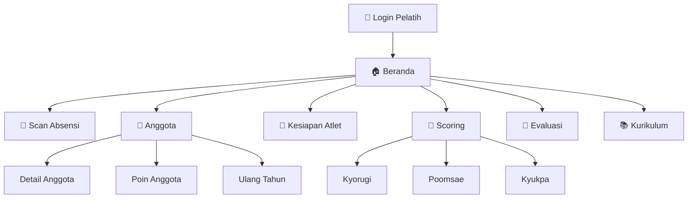

---

 

# 📚 SHOWCASE PER FITUR

---

## 1. 🏠 Beranda Pelatih

> **Route**: `/dashboard`, `/m/:momentId`

* **Kelebihan Menjual**: Pusat komando pelatih — ringkasan kegiatan, akses cepat ke semua fitur, dan **Momen Latihan** (tautan momen dapat dibuka publik via `PublicMomentViewer`) untuk dibagikan ke orang tua.
* **Dampak Bisnis**: Pelatih bekerja lebih cepat dan dokumentasi latihan menjadi materi promosi dojang.

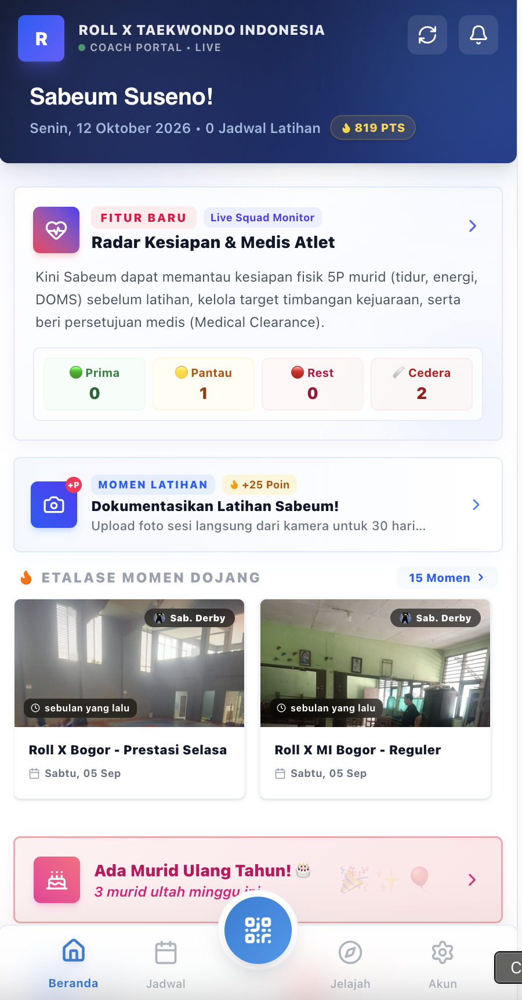  
*Gambar 1: Beranda Pelatih — ringkasan dan akses cepat.*

---

## 2. 🔳 Scanner Absensi QR

> **Route**: `/scan`

* **Kelebihan Menjual**: Kamera ponsel pelatih memindai QR murid untuk mencatat kehadiran per jadwal. Tidak butuh perangkat tambahan.
* **Dampak Bisnis**: Presensi akurat, waktu latihan efektif, dan data kehadiran langsung masuk laporan dojang.

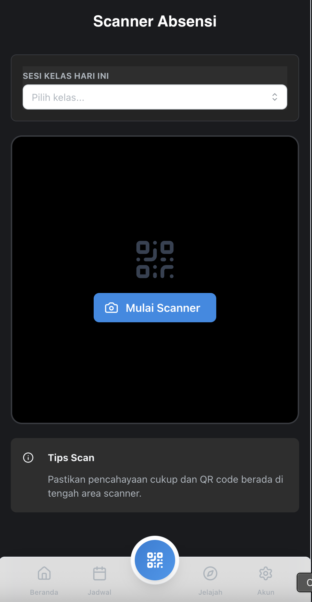  
*Gambar 2: Scanner Absensi — pemindaian QR kehadiran murid.*

---

## 3. 📅 Jadwal Mengajar & Presensi Pelatih

> **Route**: `/schedule`, `/my-attendance`

* **Jadwal**: Jadwal kelas yang diampu pelatih, per lokasi dan hari.
* **My Attendance**: Rekap kehadiran mengajar pelatih sebagai dasar evaluasi dan honor.
* **Dampak Bisnis**: Transparansi kerja pelatih, penjadwalan rapi.

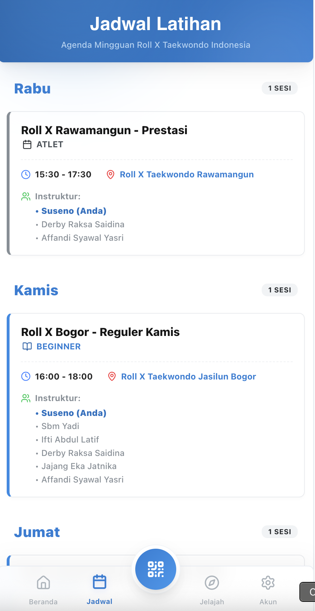  
*Gambar 3: Jadwal Mengajar — kelas yang diampu pelatih.*

---

## 4. 👥 Manajemen Anggota

> **Route**: `/members`, `/members/:id`, `/members/:id/points`, `/members/birthdays`

| Fitur | Manfaat |
| :--- | :--- |
| **Daftar Anggota** | Cari dan lihat murid binaan. |
| **Detail Anggota** | Profil, sabuk, dan perkembangan murid. |
| **Poin Anggota** | Riwayat poin sebagai sistem apresiasi dan motivasi. |
| **Ulang Tahun** | Pengingat ulang tahun murid untuk ucapan personal. |

* **Dampak Bisnis**: Hubungan pelatih–murid lebih personal sehingga retensi naik.

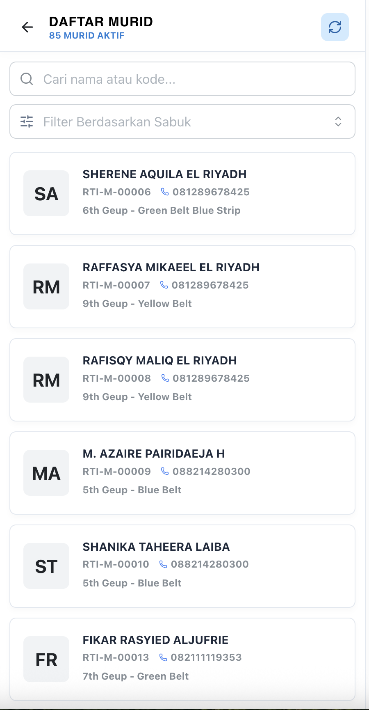  
*Gambar 4: Anggota — daftar murid binaan dan detail profil.*

---

## 5. 💪 Readiness Board — Kesiapan Atlet

> **Route**: `/readiness`, `/readiness/member/:id`

Pelatih melihat data yang dicatat atlet di aplikasi Member dan memberi tindakan.

* **Squad Readiness**: Status warna kesiapan atlet sebelum sesi latihan:
  - 🟢 **≥ 80%** — boleh sparring keras.
  - 🟡 **60–79%** — latihan teknik/drill reguler.
  - 🔴 **< 60% atau ada cedera nyeri berat** — program alternatif atau istirahat aktif.
* **Persetujuan Medis & Rehab**: Menuliskan instruksi rehab dan menetapkan atlet sembuh (*medical clearance*).
* **Target Kelas Tanding**: Menetapkan target berat badan dan event yang dituju.
* **Detail Atlet** (`/readiness/member/:id`): Riwayat wellness, berat badan, beban latihan, dan rekap tanding per atlet.
* **Dampak Bisnis**: Program latihan berbasis data, risiko cedera menurun, dan pembinaan prestasi lebih profesional.

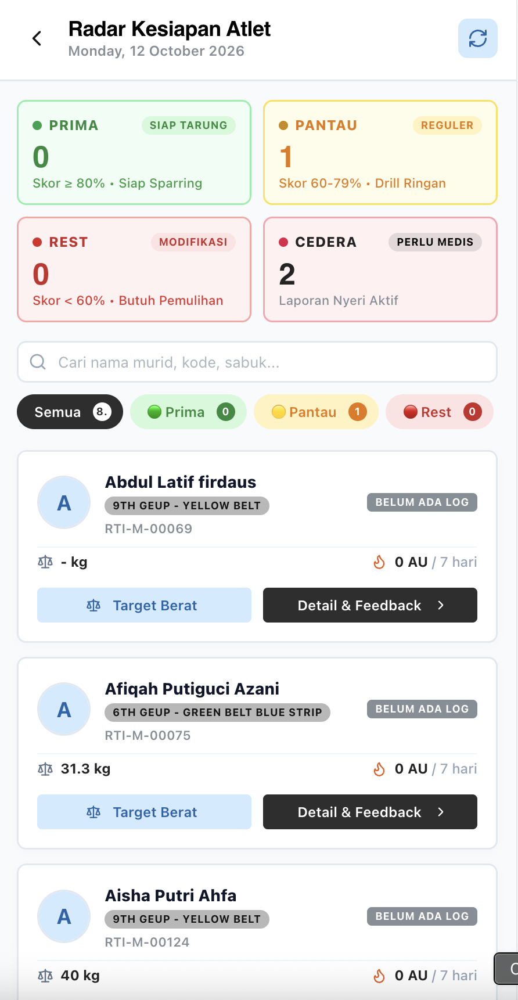  
*Gambar 5: Readiness Board — kesiapan seluruh atlet dalam satu layar.*

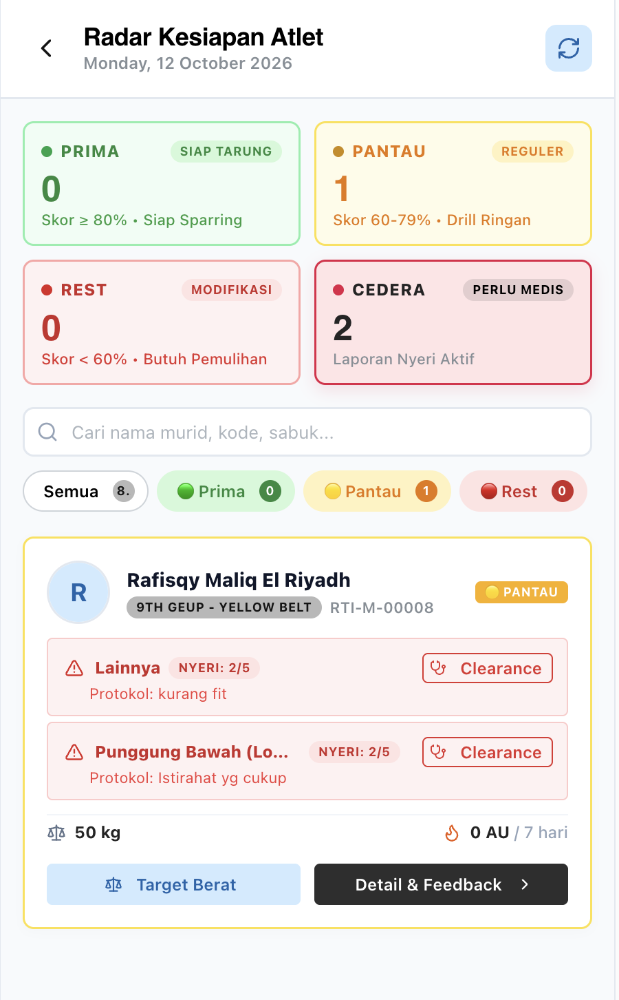  
*Gambar 6: Persetujuan Medis & Rehab dan Target Kelas Tanding.*

---

## 6. 🥊 Digital Scoring — Kyorugi, Poomsae & Kyukpa

> **Route**: `/scoring`, `/poomsae`, `/kyukpa` (+ `/…/history`, serta layar penuh `/…/match/…`)

| Disiplin | Route | Mode Pakai |
| :--- | :--- | :--- |
| **Kyorugi (Tanding)** | `/scoring` → `/scoring/match/:chungId/:hongId` | Pilih dua atlet (Chung vs Hong) lalu masuk layar penilaian penuh. |
| **Poomsae (Jurus)** | `/poomsae` → `/poomsae/match/:memberId` | Penilaian per atlet. |
| **Kyukpa (Pemecahan)** | `/kyukpa` → `/kyukpa/match/:memberId` | Penilaian per atlet. |

* **Riwayat**: Setiap disiplin memiliki tab *history* untuk melihat hasil penilaian sebelumnya.
* **Kelebihan Menjual**: Layar penilaian penuh tanpa footer agar fokus saat berlatih atau uji tanding internal. Hasil tersimpan sebagai data perkembangan atlet.
* **Dampak Bisnis**: Latihan tanding dan poomsae terdokumentasi — pelatih dan atlet dapat membandingkan progres dari waktu ke waktu.

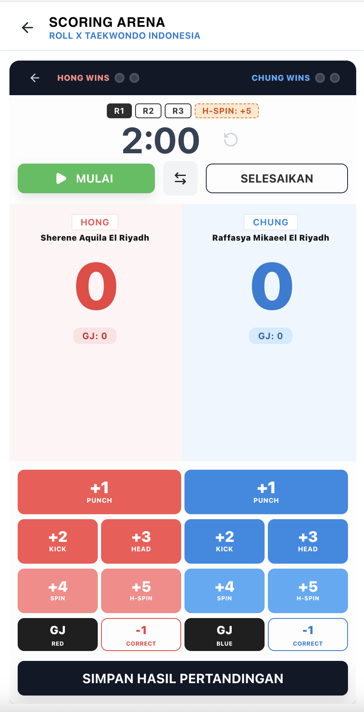  
*Gambar 7: Scoring Kyorugi — layar penilaian pertandingan.*

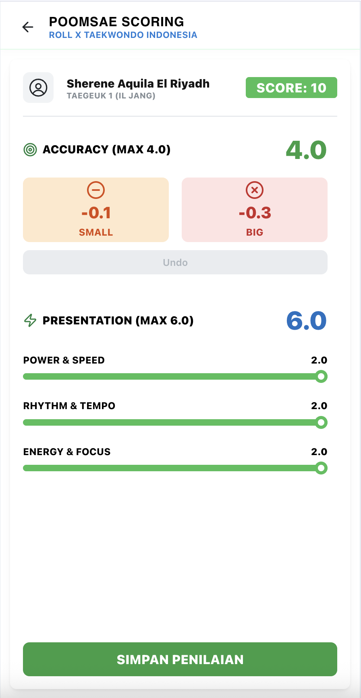  
*Gambar 8: Scoring Poomsae — penilaian jurus per atlet.*

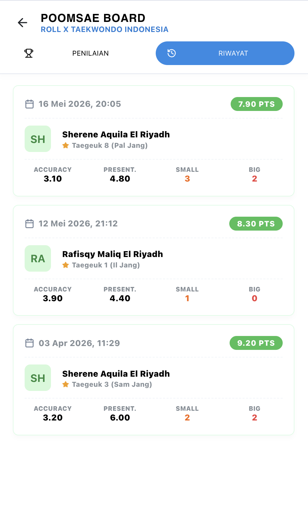  
*Gambar 9: Riwayat Penilaian — data perkembangan atlet.*

---

## 7. 📝 Evaluasi & 📚 Kurikulum

> **Route**: `/evaluasi`, `/curriculum`

* **Evaluasi**: Penilaian perkembangan murid secara terstruktur.
* **Kurikulum**: Materi dan teknik per tingkatan sabuk (data kurikulum & teknik) yang seragam untuk seluruh pelatih.
* **Dampak Bisnis**: Standar mutu pengajaran konsisten antar pelatih dan antar cabang.

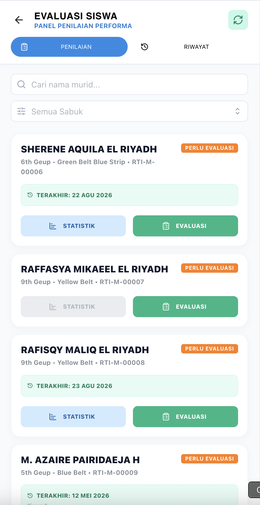  
*Gambar 10: Evaluasi Murid — catatan perkembangan terstruktur.*

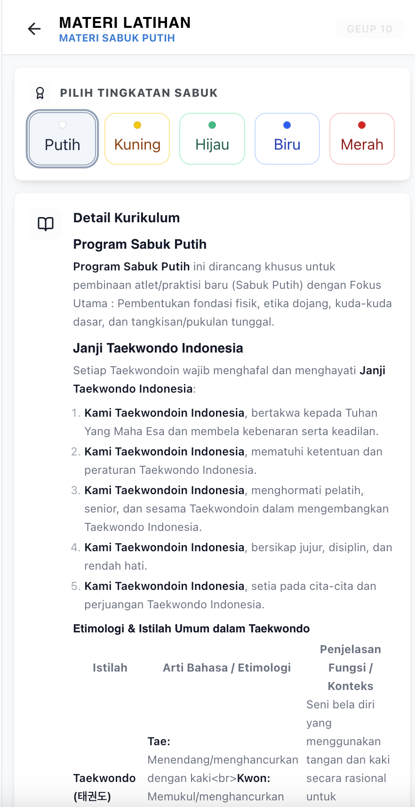  
*Gambar 11: Kurikulum — materi per tingkatan sabuk.*

---

## 8. ⚙️ Akun, Dojang & Dukungan

> **Route**: `/settings`, `/settings/profile`, `/settings/password`, `/settings/dojang`, `/settings/points`, `/settings/support`, `/settings/testimonial`, `/inbox`

| Fitur | Manfaat |
| :--- | :--- |
| **Edit Profil** | Perbarui data pelatih. |
| **Ganti Password** | Keamanan akun. |
| **Info Dojang** | Informasi dojang tempat mengajar. |
| **Poin** | Akses pengaturan/riwayat poin. |
| **Bantuan (Support)** | Hubungi tim dukungan. |
| **Testimoni** | Pelatih membagikan pengalaman — bahan promosi. |
| **Inbox** | Pengumuman dan notifikasi dari dojang. |

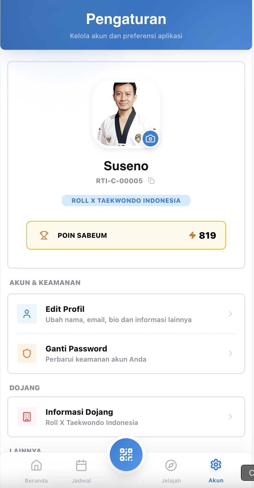  
*Gambar 12: Akun — profil, dojang, dan bantuan.*

---

## 📊 Matriks Fitur Coach

| Kategori | Fitur | Route |
| :--- | :--- | :--- |
| **Operasional** | Beranda, Scan Absensi, Jadwal, Presensi Pelatih | `/dashboard`, `/scan`, `/schedule`, `/my-attendance` |
| **Anggota** | Daftar, Detail, Poin, Ulang Tahun | `/members*` |
| **Pembinaan Atlet** | Readiness Board, Detail Atlet, Persetujuan Medis, Target Kelas | `/readiness*` |
| **Penilaian** | Kyorugi, Poomsae, Kyukpa + Riwayat | `/scoring`, `/poomsae`, `/kyukpa` |
| **Pengembangan** | Evaluasi, Kurikulum | `/evaluasi`, `/curriculum` |
| **Komunikasi** | Inbox, Jelajah | `/inbox`, `/explore` |
| **Akun** | Profil, Password, Info Dojang, Support, Testimoni | `/settings/*` |

---

## 💼 Nilai Bisnis bagi Dojang

1. **Waktu Latihan Lebih Efektif** — Absensi dan administrasi tidak lagi memakan menit-menit berharga.
2. **Keselamatan Atlet** — Keputusan beban latihan berdasarkan data kesiapan dan status cedera.
3. **Standar Mutu Pengajaran** — Kurikulum dan evaluasi seragam antar pelatih.
4. **Perkembangan Terdokumentasi** — Riwayat scoring menjadi bukti progres untuk orang tua dan seleksi atlet.
5. **Motivasi & Retensi** — Poin dan ucapan ulang tahun meningkatkan keterikatan murid.

---

## 🚀 Langkah Selanjutnya

Hubungi tim kami untuk **demo aplikasi pelatih**, onboarding pelatih, dan integrasi dengan Admin Dojang dan aplikasi Member dojang Anda.
