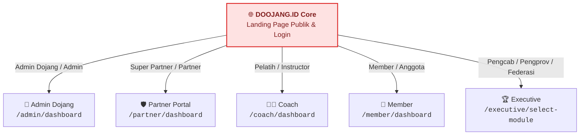
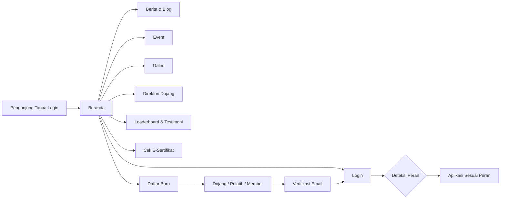
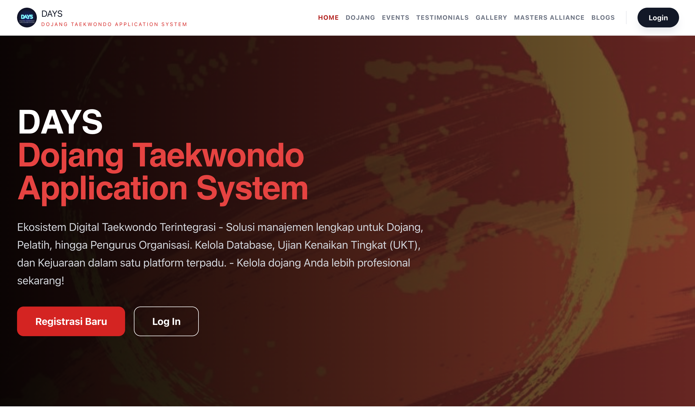
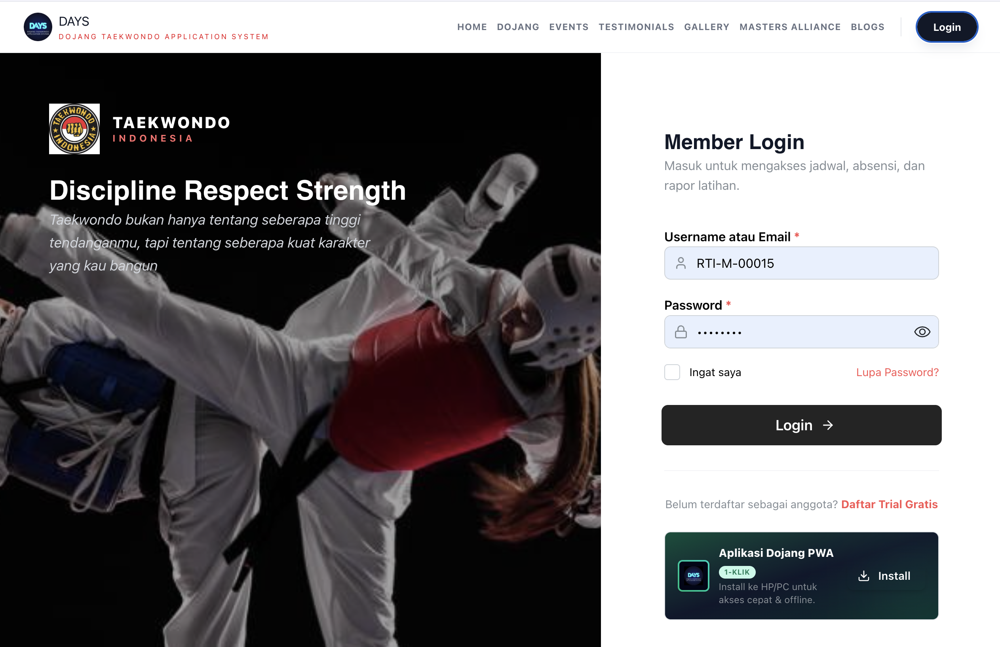
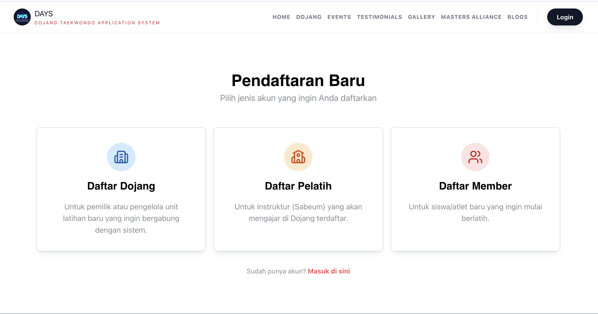
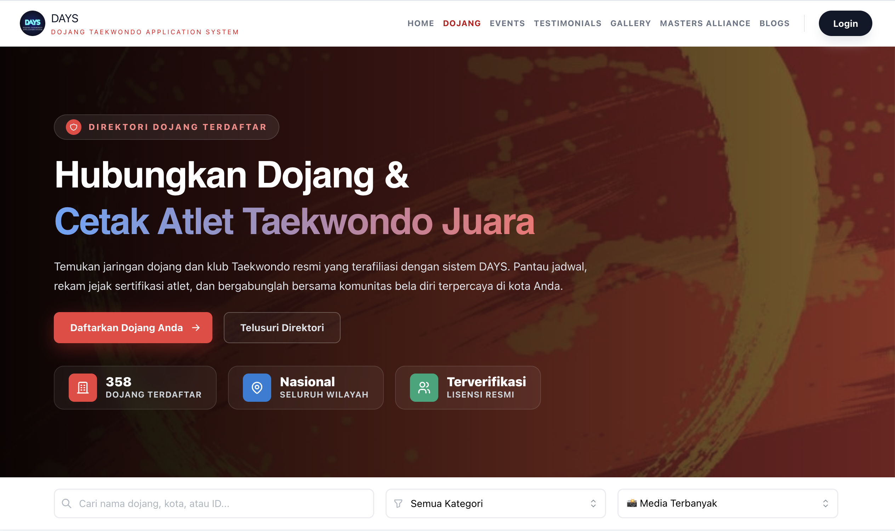
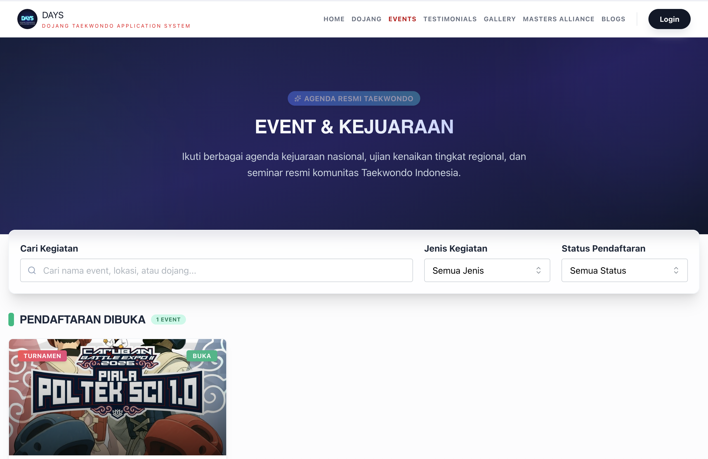
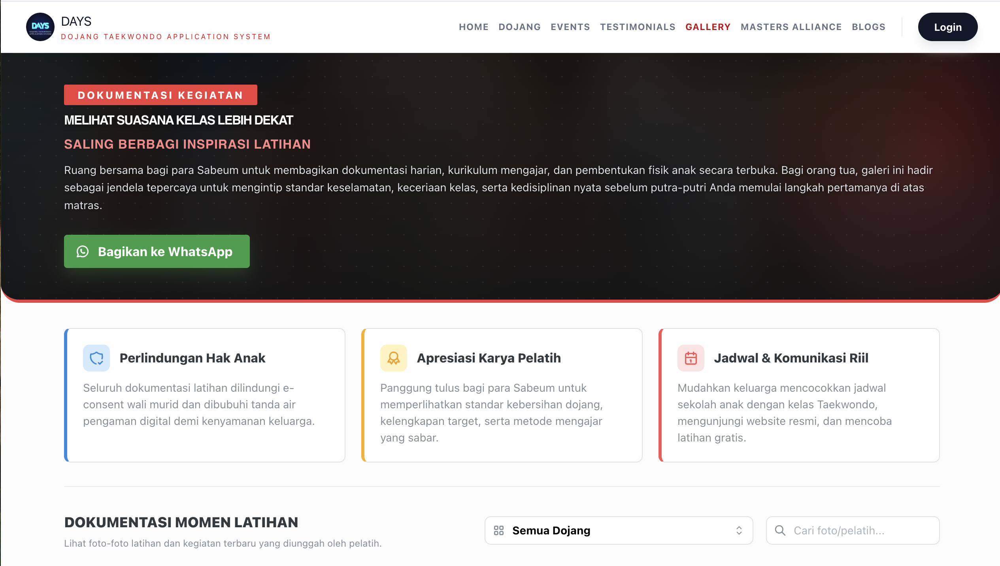
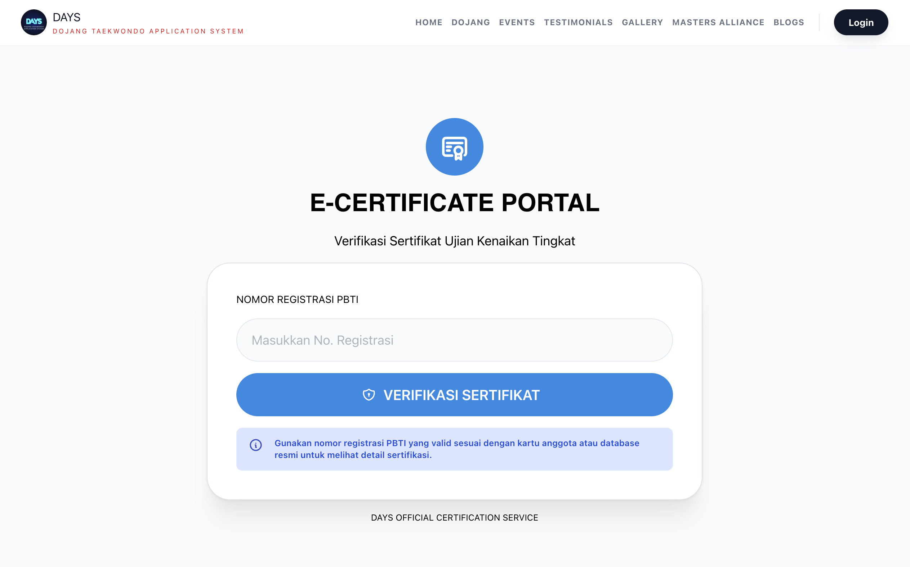
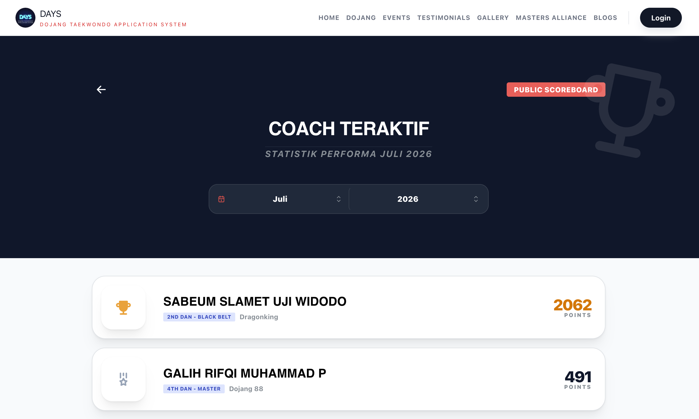

# 🥋 DOOJANG.ID Core — Official Marketing Kit & Product Deck

> **Gerbang Digital Publik Ekosistem Taekwondo Indonesia**  
> Landing page informasi terbuka tanpa login: profil, berita, event, galeri, direktori dojang, papan peringkat, verifikasi sertifikat — sekaligus **pintu masuk tunggal (single sign-in)** yang mengarahkan setiap pengguna ke aplikasi sesuai perannya.

---

## 🎯 Mengapa DOOJANG.ID Core? (Problem vs. Solution)

| ❌ Kendala Tradisional | ✅ Solusi dengan DOOJANG.ID Core |
| :--- | :--- |
| **Informasi Tersebar**: Berita, jadwal kejuaraan, dan profil organisasi hanya ada di media sosial dan grup chat. | **Satu Portal Publik Resmi**: Beranda, About, Blog, Event, dan Galeri yang terbuka untuk siapa saja tanpa login. |
| **Sulit Mencari Dojang**: Calon murid tidak tahu dojang resmi terdekat. | **Direktori Dojang**: Daftar dojang terdaftar yang dapat dijelajahi publik. |
| **Sertifikat Rawan Dipalsukan**: Keabsahan sertifikat sulit diperiksa pihak ketiga. | **Cek E-Sertifikat Publik**: Masukkan nomor registrasi atau scan QR untuk memeriksa keabsahan. |
| **Prestasi Tidak Terpublikasi**: Hasil dan peringkat tidak mudah diakses. | **Leaderboard Publik** dan **Testimoni** untuk membangun kepercayaan. |
| **Banyak Aplikasi, Banyak Login**: Admin, pelatih, murid, dan pengurus harus tahu alamat masing-masing. | **Satu Halaman Login, Redirect Otomatis**: Sistem mengenali peran dan mengarahkan ke aplikasi yang tepat. |
| **Pendaftaran Ribet**: Dojang, pelatih, dan murid mendaftar lewat jalur berbeda. | **Satu Halaman Pendaftaran Baru** dengan tiga jalur: Dojang, Pelatih, Member. |

---

## 👥 Target Pengunjung

1. **Calon Murid & Orang Tua** — Mencari dojang, melihat galeri, event, dan testimoni.
2. **Dojang, Pelatih, & Atlet** — Mendaftar dan masuk ke aplikasi masing-masing.
3. **Pengurus Federasi (Pengcab/Pengprov/Pusat)** — Masuk ke portal pengelolaan wilayah.
4. **Panitia, Sponsor, & Pihak Ketiga** — Memverifikasi sertifikat dan melihat informasi event.
5. **Masyarakat Umum & Media** — Membaca berita dan blog.

---

## 🏛️ Posisi dalam Ekosistem DOOJANG.ID

Core adalah **lapisan terdepan**: informasi publik dan gerbang login. Seluruh fitur privat berada di aplikasi lain.

---

## ⚡ Alur Pengunjung

---

 

# 📚 SHOWCASE PER HALAMAN

---

## 1. 🏠 Beranda (Landing Page)

> **Route**: `/`

* **Kelebihan Menjual**: Halaman depan yang menampilkan identitas organisasi, kartu informasi publik, testimoni (**Apa Kata Mereka**), dan sorotan pelatih (**Coach Teraktif Periode Ini**).
* **Dampak Bisnis**: Kesan pertama profesional bagi calon murid, sponsor, dan mitra; mendorong pendaftaran dan kepercayaan.

  
*Gambar 1: Beranda — landing page publik DOOJANG.ID.*

---

## 2. 🔐 Login Cerdas Berbasis Peran (Smart Role Redirect)

> **Route**: `/login`

Satu halaman login untuk seluruh pengguna. Setelah berhasil, sistem membaca **peran** (dan jenis dojang untuk admin) lalu mengalihkan ke aplikasi yang sesuai:

| Peran | Tujuan Setelah Login |
| :--- | :--- |
| **Admin Dojang** (dojang biasa) | `/admin/dashboard` |
| **Admin Dojang** (induk/organisasi non-dojang) | `/executive/select-module` |
| **Super Admin / Admin** | `/admin/dashboard` |
| **Super Partner / Partner** | `/partner/dashboard` |
| **Pelatih (Instructor/Coach)** | `/coach/dashboard` |
| **Member / Anggota** | `/member/dashboard` |
| **Pengcab / Pengprov / Federasi / Executive** | `/executive/select-module` |
| **Peran lain** | Kembali ke beranda |

* **Fitur pendukung**: Tampilan branding dapat dikustomisasi (gambar latar, logo, judul, dan tagline dari konten web dojang), tombol **Daftar Trial Gratis**, serta panel **install PWA satu klik** agar aplikasi bisa dipasang di ponsel.
* **Sudah login?** Pengguna yang masih memiliki sesi aktif langsung dialihkan ke aplikasinya tanpa mengisi ulang.
* **Dampak Bisnis**: Pengguna cukup mengingat satu alamat; mengurangi tiket bantuan "salah login/salah aplikasi".

  
*Gambar 2: Login — satu pintu masuk untuk semua peran.*

---

## 3. 📝 Pendaftaran Baru

> **Route**: `/register`

Tiga jalur pendaftaran dari satu halaman:

| Jalur | Untuk |
| :--- | :--- |
| **Daftar Dojang** | Pemilik/pengurus dojang yang ingin mendigitalisasi operasional. |
| **Daftar Pelatih** | Pelatih yang bergabung ke dojang. |
| **Daftar Member** | Murid/atlet baru. |

Dilengkapi **Verifikasi Email** (`/verifikasi`, `/verifikasi/:code`) untuk memastikan akun valid sebelum dipakai.

* **Dampak Bisnis**: Corong akuisisi pengguna baru yang jelas — dari pengunjung hingga akun aktif.

  
*Gambar 3: Pendaftaran Baru — pilihan jalur Dojang, Pelatih, atau Member.*

---

## 4. 🗺️ Direktori Dojang & Aliansi

> **Route**: `/dojang`, `/dojangs`, `/alliances`, `/alliance`

* **Direktori Dojang**: Daftar dojang terdaftar yang dapat dijelajahi publik oleh calon murid.
* **Informasi Aliansi**: Penjelasan jaringan/aliansi dojang dan kemitraan dalam ekosistem.
* **Dampak Bisnis**: Dojang mendapat eksposur gratis; calon murid menemukan dojang resmi dengan mudah.

  
*Gambar 4: Direktori Dojang — telusuri dojang resmi.*

---

## 5. 📰 Berita, Blog, Event & Galeri

> **Route**: `/blogs`, `/blogs/:id`, `/events`, `/events/:id`, `/gallery`, `/about`

| Halaman | Isi |
| :--- | :--- |
| **Blog & Detail** | Artikel edukasi dan berita (dikelola dari CMS Admin Dojang). |
| **Event & Detail** | Daftar event/kejuaraan beserta deskripsi dan informasi. |
| **Galeri** | Dokumentasi foto dan video kegiatan. |
| **About** | Profil, **Visi & Misi** organisasi. |

* **Dampak Bisnis**: Konten rutin meningkatkan SEO dan kepercayaan publik; informasi event mendorong partisipasi.

  
*Gambar 5: Event — informasi kejuaraan dan kegiatan.*

  
*Gambar 6: Galeri — dokumentasi kegiatan.*

---

## 6. ✅ Verifikasi E-Sertifikat Publik

> **Route**: `/e-certs`, `/e-certs/:registrationNumber`

* **Kelebihan Menjual**: Siapa pun dapat memeriksa keaslian sertifikat dengan memasukkan nomor registrasi atau membuka tautan dari QR di sertifikat. Hasil menampilkan detail sertifikat yang sah.
* **Dampak Bisnis**: Mencegah pemalsuan sertifikat sabuk dan kejuaraan; meningkatkan kredibilitas federasi dan dojang. Terhubung dengan e-sertifikat yang diterbitkan modul **Executive**.

  
*Gambar 7: Cek E-Sertifikat — verifikasi keaslian dokumen.*

  
*Gambar 8: Hasil Verifikasi — detail sertifikat yang sah.*

---

## 7. 🏅 Leaderboard & Testimoni

> **Route**: `/leaderboard`, `/testimonials`

* **Leaderboard**: Papan peringkat publik yang memotivasi atlet dan dojang.
* **Testimoni**: Kesaksian pengguna dan pelatih sebagai bukti sosial (*social proof*).
* **Dampak Bisnis**: Kompetisi sehat antar dojang dan alat promosi organik.

  
*Gambar 9: Leaderboard — peringkat publik.*

  
*Gambar 10: Testimoni — suara pengguna ekosistem.*

---

## 📊 Matriks Halaman Core

| Kategori | Halaman | Route | Perlu Login |
| :--- | :--- | :--- | :---: |
| **Landing** | Beranda, About | `/`, `/about` | ❌ |
| **Autentikasi** | Login, Daftar, Verifikasi Email | `/login`, `/register`, `/verifikasi*` | ❌ |
| **Konten** | Blog, Event, Galeri | `/blogs*`, `/events*`, `/gallery` | ❌ |
| **Direktori** | Dojang, Aliansi | `/dojang(s)`, `/alliance(s)` | ❌ |
| **Kredibilitas** | Cek E-Sertifikat, Leaderboard, Testimoni | `/e-certs*`, `/leaderboard`, `/testimonials` | ❌ |

> **Catatan Arsitektur**: Core adalah *pure public site*. Seluruh rute privat (admin, member, coach, partner, executive) telah dipisah ke aplikasi masing-masing sehingga bundle Core ringan dan cepat dimuat.

---

## 💼 Nilai Bisnis

1. **Akuisisi Pengguna** — Corong dari pengunjung menjadi dojang, pelatih, dan murid terdaftar.
2. **Kepercayaan & Legitimasi** — Verifikasi sertifikat dan direktori resmi memperkuat citra federasi.
3. **Pengalaman Login Sederhana** — Satu alamat, otomatis ke aplikasi yang tepat.
4. **SEO & Visibilitas** — Blog, event, dan galeri publik meningkatkan pencarian organik.
5. **Performa Cepat** — Situs publik ringan, nyaman dibuka dari ponsel; tersedia opsi pemasangan PWA.

---

## 🚀 Langkah Selanjutnya

Kunjungi portal DOOJANG.ID, daftarkan dojang Anda, atau hubungi tim kami untuk **demo seluruh ekosistem** (Core, Admin, Member, Coach, Executive, dan Partner).
