# 🥋 DAYS (Dojang Application System) EXECUTIVE PLATFORM — Official Marketing Kit & Product Deck

> **The Enterprise Operating System for Martial Arts Federations, Belt Grading Events, & Championship Tournaments**  
> Satu ekosistem komando digital terintegrasi yang memberdayakan Pengurus Federasi Olahraga Beladiri (PBTI/Pengprov/Pengcab), Komite Ujian Kenaikan Tingkat (UKT), dan Event Organizer Turnamen dalam mengotomatisasi tata kelola, penjadwalan, live digital scoring, hingga pencetakan sertifikat dan buku hasil kejuaraan secara instan.

---

## 🧭 Navigasi Cepat Showcase per Modul

Platform **DAYS (Dojang Application System) Executive** dibangun dengan arsitektur modular mandiri (*dual-mode capable*) yang terbagi menjadi 3 pilar operasional utama:

1. [🏛️ **Modul 1: Federasi & Tata Kelola Organisasi**](#-modul-1-federasi--tata-kelola-organisasi-federation-governance) — Audit dojang, mutasi atlet, peta sebaran teritorial, MAU tracking, dan indeks kesehatan dojang binaan.
2. [🏆 **Modul 2: Event & Ujian Kenaikan Tingkat (UKT)**](#-modul-2-event--ujian-kenaikan-tingkat-ukt--diklat) — Rubrik penilaian dinamis, grouping pos ujian, absensi QR code, tablet scoring penguji, hingga otomasi e-sertifikat ber-QR.
3. [⚔️ **Modul 3: Competition & Turnamen Kejuaraan**](#-modul-3-competition--turnamen-kejuaraan-tournament-engine) — Algoritma auto-drawing bagan, weigh-in checkpoint, call room marshalling, live scoring terminal arena, live scoreboard TV, dan export instant Result Book PDF.
4. [🌐 **Keunggulan Arsitektur: Dual-Mode Hybrid & High Resilience**](#-keunggulan-arsitektur-dual-mode-hybrid-registration) — Dukungan pendaftaran internal & kontingen tamu via Excel tanpa hambatan.
5. [💼 **Model Lisensi, Paket Harga (SaaS), & Kalkulasi ROI**](#-model-lisensi-paket-komersial-saas--kalkulasi-roi) — Paket Basic, Standard, Enterprise, hingga lisensi putus B2B White-Label.

---

## 🎛️ Arsitektur Ekosistem & Workspace Selector

Pengguna dapat memilih ruang kerja sesuai perannya melalui **Workspace Selector** (`/executive/select-module`) atau berpindah modul secara instan melalui **Module Selector Dropdown** pada bilah navigasi:

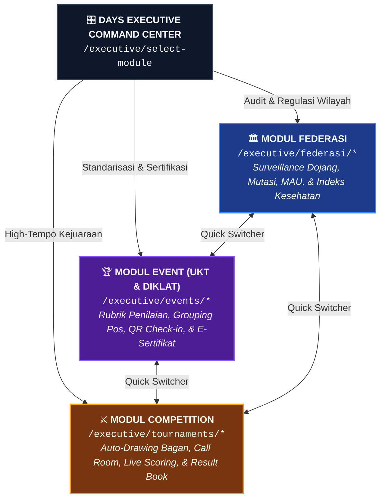

---

 

# 🏛️ MODUL 1: Federasi & Tata Kelola Organisasi (Federation Governance)

> **Kendali Penuh Wilayah, Pengawasan Keaktifan Anggota, & Integritas Mutasi Atlet**  
> Didesain khusus bagi **Pengurus Besar (PBTI Pusat)**, **Pengurus Provinsi (Pengprov)**, dan **Pengurus Cabang (Pengcab Kota/Kabupaten)** untuk mengawasi ekosistem dojang binaan tanpa ketergantungan dokumen fisik.

## 🎯 Problem vs. Solution: Modul Federasi

| ❌ Masalah Konvensional Federasi | ✅ Solusi Modul Federasi DAYS |
| :--- | :--- |
| **Data Dojang & Atlet Fiktif**: Tidak ada cara mudah memverifikasi keaktifan murid di unit-unit latihan bawah naungan. | **Sensus Terpadu & Geospasial**: Peta sebaran digital per kecamatan/wilayah, lengkap dengan statistik demografi usia, gender, dan tingkat sabuk. |
| **Sengketa Mutasi Atlet Antar-Klub**: Kepindahan atlet sering menimbulkan friksi antar-pelatih karena berkas kepindahan manual rawan dimanipulasi. | **Digital Transfer Clearance Workflow**: Sistem permohonan mutasi online dengan verifikasi surat rekomendasi/bebas kewajiban dojang asal berjenjang. |
| **Dojang Mati Suri Tanpa Pengawasan**: Federasi terlambat mengetahui dojang binaan tutup dan kehilangan potensi regenerasi atlet. | **Dojang Health Index Score**: Algoritma pelacak keaktifan harian, konsistensi ujian, dan peringatan dini dojang berisiko pasif. |
| **Kebocoran Iuran & Royalti Lisensi**: Sulit menghitung kewajiban iuran bulanan karena data kehadiran murid di dojang tidak transparan. | **MAU Usage Tracking Real-Time**: Kalkulasi otomatis *Monthly Active Users* (MAU) berbasis aktivitas presensi latihan riil di lapangan. |

## 👥 Target Pengguna Modul Federasi
- **Ketua Umum & Sekretaris Pengcab/Pengprov**: Mengawasi legalitas, pertumbuhan sabuk hitam, dan agenda kegiatan tahunan.
- **Komisi Pembinaan Prestasi (Binpres)**: Melacak talenta atlet potensial dan memantau persebaran atlet usia dini.
- **Komisi Hukum & Disiplin**: Memvalidasi kepindahan dojang dan keabsahan keanggotaan atlet.

## ⚡ Alur Tata Kelola Federasi (Governance Flow)

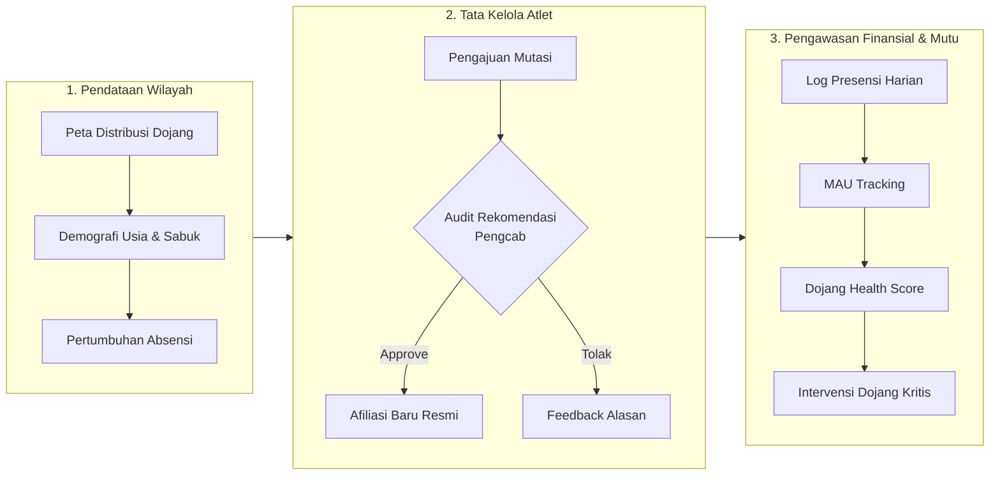

## 🌟 5 Fitur Unggulan ("WOW" Factors) — Modul Federasi

### 1. Territorial & Geospatial Heatmap
* **Kelebihan Menjual**: Pemetaan geospasial interaktif yang memvisualisasikan seluruh titik dojang resmi di peta wilayah yurisdiksi federasi. Disertai filter zonasi, kecamatan, serta kepadatan basis atlet.
* **Dampak Bisnis**: Federasi dapat mengidentifikasi wilayah *blank spot* untuk pembukaan cabang baru dan pemerataan pembinaan atlet.
* 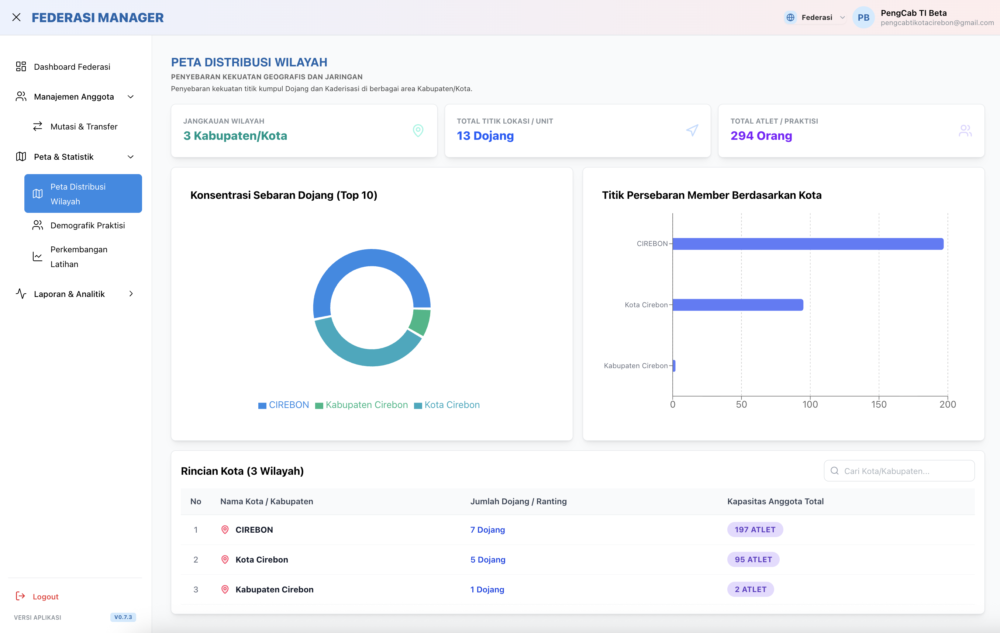  
  *Gambar 1.1: Peta Distribusi Wilayah — Visualisasi geospasial titik dojang binaan dan kepadatan sebaran sabuk.*

### 2. Digital Member Mutation & Transfer Clearance
* **Kelebihan Menjual**: Modul mutasi praktisi end-to-end dengan alur verifikasi resmi. Menyertakan audit berkas surat keluar dojang lama, persetujuan admin federasi, dan migrasi riwayat atlet tanpa menghilangkan data prestasi lampau.
* **Dampak Bisnis**: Menghilangkan sengketa perebutan atlet jelang Porprov/PON, melindungi hak dojang pembina pertama, dan menegakkan kode etik organisasi.
* 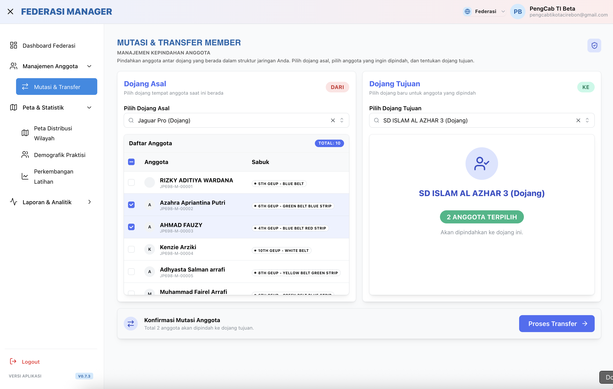  
  *Gambar 1.2: Mutasi & Transfer Anggota — Alur review administrasi kepindahan atlet antar-dojang secara transparan.*

### 3. MAU (Monthly Active Users) Usage Tracking
* **Kelebihan Menjual**: Pelacakan konsumsi lisensi pengguna aktif per dojang berbasis aktivitas check-in dan presensi riil. Grafik tren menyajikan perbandingan dojang teraktif vs dojang dengan penurunan murid.
* **Dampak Bisnis**: Basis penetapan tagihan iuran daerah atau royalti lisensi yang adil, akuntabel, dan bebas sanggahan.

### 4. Predictive Dojang Health Index Score
* **Kelebihan Menjual**: Sistem skor cerdas (0–100) yang mengukur vitalitas dojang berdasarkan kontinuitas jadwal latihan, rasio kehadiran pelatih, partisipasi UKT, dan rasio murid baru vs churn.
* **Dampak Bisnis**: Deteksi dini pencegahan penutupan dojang 3–6 bulan lebih awal, memungkinkan pengurus cabang melakukan intervensi pendampingan.

### 5. Unified Athlete Career Passport & Hall of Fame (Roadmap Ready)
* **Kelebihan Menjual**: Riwayat hidup atlet digital (*Single Athlete Identity*) yang merekam jejak kenaikan sabuk dari Sabuk Putih hingga DAN Kukkiwon, histori lawan di turnamen, medali yang dimenangkan, serta status lisensi wasit/pelatih.
* **Dampak Bisnis**: Database aset atlet daerah terpusat yang menjadi basis seleksi Pelatda/Pelatnas tanpa manipulasi rekam jejak.

## 📊 Matriks Fitur Lengkap Modul Federasi

| Fitur Modul Federasi | Route URL | Target Output / Nilai Tambah |
| :--- | :--- | :--- |
| **Dashboard Federasi** | `/federasi/dashboard` | Ringkasan KPI makro (Total Dojang, Total Atlet, Rasio Gender, Pertumbuhan Absensi). |
| **Mutasi & Transfer Anggota** | `/federasi/transfer-member` | Approval kepindahan atlet antar-dojang & update otomatis afiliasi `dojang_id`. |
| **Peta Distribusi Wilayah** | `/federasi/territorial` | Peta interaktif zonasi sebaran dojang per kabupaten/kota/kecamatan. |
| **Demografik Praktisi** | `/federasi/demographics` | Piramida usia, rasio gender, dan komposisi tingkatan sabuk Geup 10 s/d DAN. |
| **Perkembangan Latihan** | `/federasi/attendance-growth` | Analitik tren kehadiran sesi latihan lintas dojang secara mingguan/bulanan. |
| **MAU Usage Tracking** | `/federasi/mau` | Rekapitulasi murid aktif bulanan per unit latihan untuk kebutuhan audit iuran. |
| **Kesehatan Dojang** | `/federasi/dojang-health` | Skor kesehatan operasional dojang dan peringatan dojang berstatus waspada/pasif. |
| **Monitoring Kegiatan** | `/federasi/activities` | Feed aktivitas live kegiatan harian dojang, ujian, dan diklat pelatih. |

---

 

# 🏆 MODUL 2: Event & Ujian Kenaikan Tingkat (UKT & Diklat)

> **Automasi Total Siklus Ujian Kenaikan Tingkat & Sertifikasi Beladiri Standar Nasional**  
> Mengeliminasi tumpukan kertas formulir penilaian, manual grouping pos penguji, dan antrean cetak sertifikat konvensional dengan alur serba digital dan transparan.

## 🎯 Problem vs. Solution: Modul Event (UKT)

| ❌ Kendala Ujian Konvensional | ✅ Solusi Modul Event DAYS |
| :--- | :--- |
| **Kertas Penilaian Menumpuk & Berantakan**: Penguji menulis di kertas formulir yang rawan hilang, terkena air, atau tulisan tangan tak terbaca. | **Terminal Penilaian Penguji Digital**: Penguji menilai via tablet/smartphone per pos ujian dengan kalkulasi nilai akhir otomatis. |
| **Pembagian Pos/Gelanggang Tidak Seimbang**: Antrean peserta di pos poomsae menumpuk ratusan orang sementara pos fisik kosong. | **Algoritma Pooling & Grouping Otomatis**: Peserta dibagi rata ke pos ujian dan sesi waktu sesuai kapasitas gelanggang. |
| **Verifikasi Kehadiran Manual & Memakan Waktu**: Panitia memanggil absen dengan pengeras suara berjam-jam. | **Fast QR Code Check-In**: Peserta cukup scan QR pada ID Card di pos kedatangan; status kehadiran terupdate dalam hitungan milidetik. |
| **Penerbitan Sertifikat Butuh Berminggu-minggu**: Panitia mengetik satu per satu nama peserta dan nomor registrasi di template sertifikat. | **One-Click Instant E-Certificate Generator**: Ratusan e-sertifikat ber-QR terbit otomatis sesuai status kelulusan lengkap dengan link verifikasi publik. |

## 👥 Target Pengguna Modul Event
- **Ketua Penguji & Master Penguji**: Mengonfigurasi rubrik penilaian kompetensi dan menetapkan batas ambang kelulusan.
- **Panitia & Tim Staff Registrasi**: Memvalidasi bukti pembayaran kontingen, mencetak ID Card, dan mengelompokkan pos.
- **Manajer Dojang & Pelatih Kontingen**: Mendaftarkan atlet secara kolektif dan memantau status kelulusan murid secara langsung.

## ⚡ Alur Siklus Ujian Kenaikan Tingkat (Exam Lifecycle)

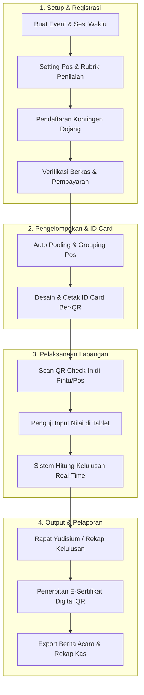

### State Machine Transisi Peserta Event:
$$\mathbf{REGISTERED} \longrightarrow \mathbf{PAID} \longrightarrow \mathbf{VERIFIED} \longrightarrow \mathbf{GROUPED} \longrightarrow \mathbf{CHECKED\_IN} \longrightarrow \mathbf{SCORED} \longrightarrow \mathbf{GRADUATED}$$

## 🌟 5 Fitur Unggulan ("WOW" Factors) — Modul Event

### 1. Dynamic Rubric Scoring Templates & Multi-Station Arena
* **Kelebihan Menjual**: Konfigurasi rubrik kompetensi yang fleksibel (Poomsae, Kyorugi Dasar, Fisik/Kuda-kuda, Pemecahan Papan/Kyukpa, Sikap/Etika). Bobot persentase nilai dapat disesuaikan per tingkatan sabuk.
* **Dampak Bisnis**: Standarisasi ujian terjamin mutunya, kredibel di mata orang tua murid, dan mudah disesuaikan dengan kurikulum resmi PBTI/Kukkiwon.
* 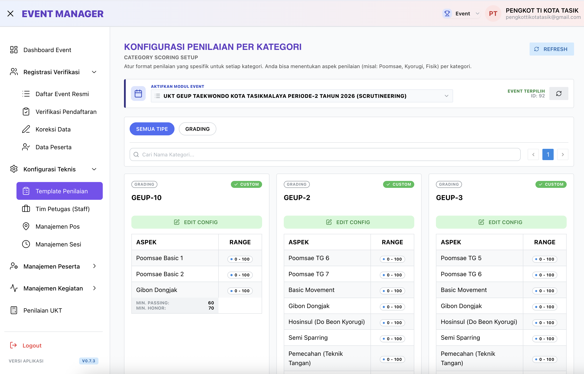  
  *Gambar 2.1: Template Rubrik Penilaian — Kustomisasi kriteria evaluasi ujian kenaikan tingkat sesuai silabus.*

### 2. Smart Pooling & Grouping Engine
* **Kelebihan Menjual**: Pembagian otomatis ratusan peserta ke dalam pos-pos penguji (*Station A, Station B, dst.*) dan gelombang sesi waktu (*Batch Pagi / Siang*) dengan distribusi beban kerja yang seimbang.
* **Dampak Bisnis**: Mengurangi waktu tunggu peserta hingga 60%, mencegah penumpukan massa di venue, dan memastikan waktu selesai ujian tepat jadwal.
* 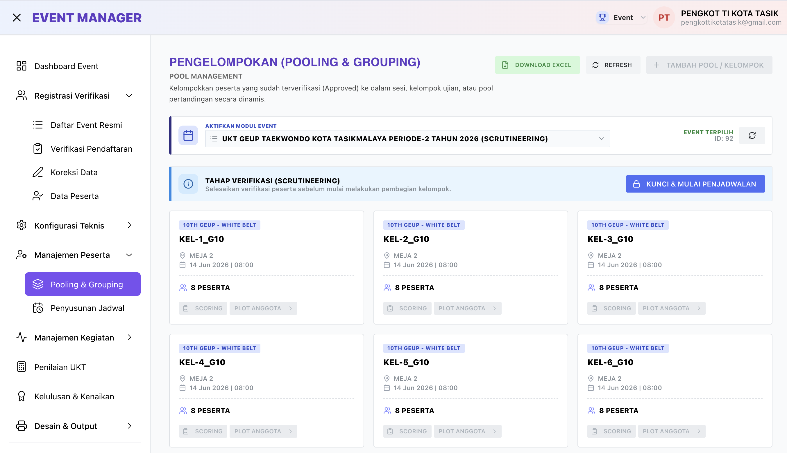  
  *Gambar 2.2: Pooling & Grouping Peserta — Distribusi otomatis peserta ke pos evaluasi dan alokasi sesi waktu.*

### 3. QR Code Instant Check-In & Badging System
* **Kelebihan Menjual**: Setiap peserta dan official mendapatkan ID card ber-QR unik. Panitia cukup menggunakan kamera ponsel untuk memindai kehadiran saat atlet tiba di pintu masuk atau pos ujian.
* **Dampak Bisnis**: Meniadakan antrean panjang pendaftaran ulang di pagi hari, akurasi absensi 100%, dan data langsung sinkron ke dashboard panitia.
* 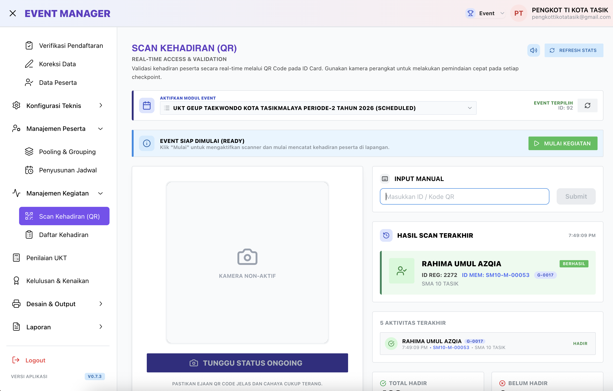  
  *Gambar 2.3: Scan Kehadiran QR — Check-in kilat berbasis pemindaian ID Card tanpa pencatatan manual.*

### 4. Real-time Digital Examiner Tablet Scoring
* **Kelebihan Menjual**: Antarmuka penilaian responsif layar sentuh yang dirancang khusus untuk penguji di pinggir lapangan. Penguji cukup menekan tombol skor per aspek kriteria; total skor terhitung otomatis.
* **Dampak Bisnis**: Hasil ujian langsung masuk ke sistem tanpa perlu petugas pengumpul berkas atau staf input data manual (*zero data-entry lag*).
* 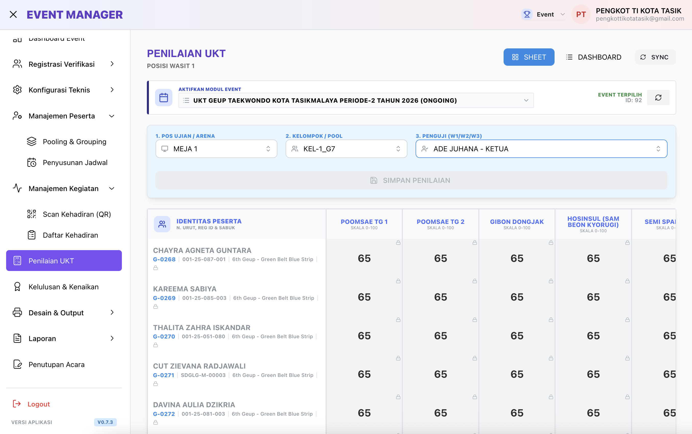  
  *Gambar 2.4: Terminal Penilaian Penguji — Input nilai berbasis layar sentuh dengan kalkulasi kelulusan seketika.*

### 5. Automated E-Certificate Generator with Public QR Verification
* **Kelebihan Menjual**: Mesin generator sertifikat yang mampu mencetak ribuan sertifikat digital beresolusi tinggi dalam hitungan menit lengkap dengan QR Code validasi keaslian dokumen.
* **Dampak Bisnis**: Memangkas biaya cetak kertas sertifikat hingga ratusan juta rupiah per tahun, mencegah pemalsuan sertifikat sabuk, dan sertifikat dapat langsung diunduh wali murid.
* 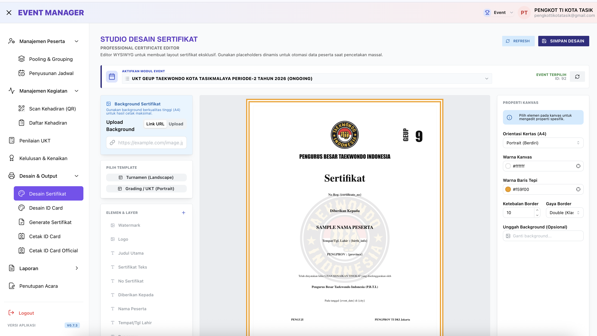  
  *Gambar 2.5: Generator Sertifikat Digital — Penerbitan sertifikat digital ber-QR instan siap unduh dan cetak.*

## 📊 Matriks Fitur Lengkap Modul Event

| Sub-Modul | Path Halaman | Kemampuan Utama |
| :--- | :--- | :--- |
| **Dashboard Event** | `/events/dashboard` | Statistik pendaftar, progres verifikasi bayar, dan kehadiran pos real-time. |
| **Registrasi & Verifikasi** | `/events/registrations` | Audit bukti transfer bank, pengecekan sabuk terakhir, & verifikasi berkas. |
| **Koreksi Data Peserta** | `/events/correction` | Koreksi cepat nama peserta, tanggal lahir, dan dojang asal sebelum hari-H. |
| **Data Peserta Master** | `/events/participants` | Direktori lengkap seluruh atlet terdaftar beserta status administrasi. |
| **Template Penilaian** | `/events/scoring-templates` | Builder rubrik kriteria ujian, skala nilai (1–100), dan formula kelulusan. |
| **Pos & Sesi Ujian** | `/events/arenas` & `/events/sessions` | Penataan jumlah gelanggang/pos ujian dan pembagian slot jam operasional. |
| **Grouping Peserta** | `/events/grouping` | Algoritma penyeimbang antrean peserta ke pos penguji. |
| **Desain & Cetak ID Card** | `/events/output/id-cards` | Batch print layout ID Card ukuran standar lengkap dengan QR Code & foto. |
| **Terminal Penilaian** | `/events/scoring` | Web interface tablet penguji untuk pemberian nilai live. |
| **Kelulusan & Kenaikan** | `/events/graduation` | Review kelulusan, penetapan predikat (Terbaik/Lulus/Tunda), & promosi sabuk. |
| **Cetak Sertifikat** | `/events/output/generate-certificate` | Otomasi ekspor ratusan PDF sertifikat ber-QR dengan tata letak elegan. |
| **Rekapitulasi Keuangan** | `/events/reports/payments` | Laporan rekonsiliasi kas pendaftaran kontingen vs biaya sewa & konsumsi. |
| **Penutupan Acara** | `/events/closing` | Pembuatan Berita Acara resmi (BAP) dan finalisasi arsip event. |

---

 

# ⚔️ MODUL 3: Competition & Turnamen Kejuaraan (Tournament Engine)

> **Mesin Turnamen Berkecepatan Tinggi: Auto-Drawing, Live Call Room, Digital Scoring, & Instant Result Book**  
> Mengakomodasi tensi tinggi kejuaraan taekwondo kategori **Kyorugi (Tanding)** dan **Poomsae (Seni Jurus)** dari skala kejuaraan cabang (Kejurcab) hingga Open Tournament nasional ribuan partai.

## 🎯 Problem vs. Solution: Modul Turnamen

| ❌ Kendala Turnamen Tradisional | ✅ Solusi Modul Turnamen DAYS |
| :--- | :--- |
| **Drawing Bagan Rawan Titipan/Protes**: Pengundian manual di technical meeting sering dicurigai rekayasa dan memakan waktu semalaman. | **Algoritma Auto-Drawing Netral**: Sistem mengundi bagan secara acak murni atau seeded-bracket dengan pemisahan atlet satu dojang di pool berbeda. |
| **Jadwal Bentrok & Lapangan Menganggur**: Partai tertunda karena atlet belum siap atau satu atlet bermain di dua arena bersamaan. | **Load Balancer Jadwal & Call Room**: Sistem penjadwalan cerdas mendeteksi jeda istirahat atlet dan memanggil peserta 3 partai sebelum tanding. |
| **Sistem Timbang Badan Manual**: Verifikasi berat badan di buku manual lambat dan rawan atlet lolos tanpa timbang. | **Checkpoint Weigh-In Digital**: Petugas mencatat bobot riil di gate timbang; atlet diskualifikasi langsung otomatis tercoret dari bagan. |
| **Penonton & Pelatih Buta Jadwal**: Penonton berdesakan di depan meja panitia menanyakan kapan nomor partainya bertanding. | **Public Display TV & Arena Scoreboard**: Tampilan jadwal layar lebar (*Scoreboard Arena*) dan display bagan publik yang update otomatis. |
| **Buku Hasil (Result Book) Selesai Berhari-hari**: Panitia butuh waktu berhari-hari untuk merekap juara, pemenang medali, dan kontingen juara umum. | **Instant One-Click Result Book PDF**: Buku hasil turnamen resmi puluhan halaman (rekap bagan, perolehan medali, best player) selesai dalam 5 detik. |

## 👥 Target Pengguna Modul Turnamen
- **Technical Delegate (TD) & Ketua Pertandingan**: Menentukan regulasi turnamen, menyetujui bagan, dan mengawasi jalannya kejuaraan.
- **Chief Referee (Wasit Utama)**: Menugaskan juri/wasit gelanggang dan memimpin penyelesaian nota protes (mitigasi issue).
- **Operator Meja Gelanggang (Scoring Operator)**: Mengoperasikan terminal skor poin lapangan dan mengatur timer ronde.
- **Marshalling / Petugas Call Room**: Memastikan atlet menggunakan pelindung (PSS/DSSA), timbang badan sah, dan mengawal ke gelanggang.

## ⚡ Alur Kejuaraan Berkecepatan Tinggi (Tournament Engine Flow)

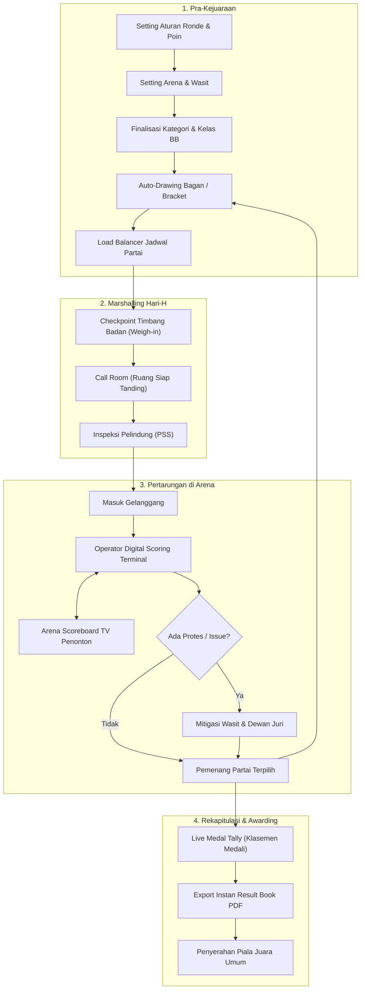

### State Machine Transisi Partai Pertandingan:
$$\mathbf{SCHEDULED} \longrightarrow \mathbf{CALLED\ (Call\ Room)} \longrightarrow \mathbf{ON\_ARENA} \longrightarrow \mathbf{IN\_PROGRESS} \longrightarrow \mathbf{FINISHED} \longrightarrow \mathbf{VERIFIED}$$

## 🌟 5 Fitur Unggulan ("WOW" Factors) — Modul Turnamen

### 1. Algorithmic Bracket Auto-Drawing & Dynamic Schedule Load Balancer
* **Kelebihan Menjual**: Generator bagan pertandingan sistem gugur (*Single Elimination / Double Elimination*) yang cerdas. Secara otomatis memisahkan atlet dari kontingen/dojang yang sama di pool atas dan pool bawah. Penjadwal (*Load Balancer*) mendistribusikan ratusan partai ke 1–8 arena dengan alokasi estimasi durasi pertandingan yang akurat.
* **Dampak Bisnis**: Technical meeting yang biasanya berlangsung hingga larut malam dapat diselesaikan dalam 15 menit, transparan dan bebas tuduhan manipulasi drawing.
* 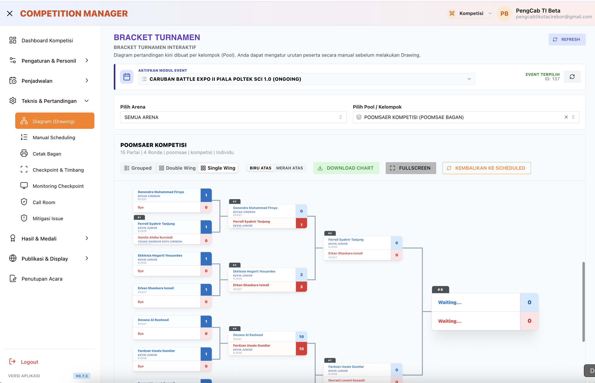  
  *Gambar 3.1: Diagram Bagan Pertandingan — Visualisasi bagan sistem gugur otomatis dan struktur pool kategori tanding.*

### 2. Digital Weigh-in Checkpoint & Call Room Marshalling
* **Kelebihan Menjual**: Sistem antrean dua lapis: bilik timbang badan (*Weigh-in*) dan ruang tunggu atlet (*Call Room*). Status atlet langsung berubah menjadi *Ready / Diskualifikasi Overweight / Siap Masuk Arena*.
* **Dampak Bisnis**: Arena pertandingan tidak pernah kosong menunggu atlet, jadwal berjalan tepat waktu (*zero arena downtime*), dan transparansi berat badan atlet terjamin.
* 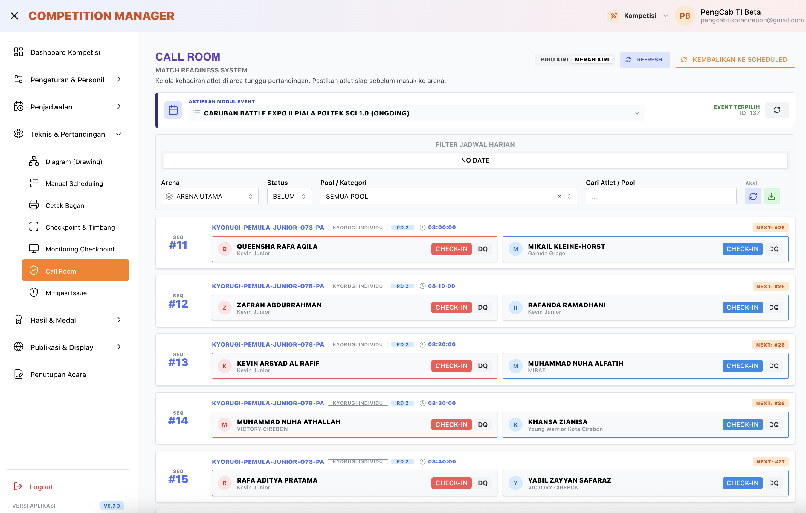  
  *Gambar 3.2: Call Room Marshalling — Monitor antrean atlet siap tanding dan verifikasi timbang badan sebelum gelanggang.*

### 3. Real-Time Arena Scoring Terminal & Fullscreen Public TV Display
* **Kelebihan Menjual**: Terminal operator pencatat skor digital yang terhubung langsung ke layar display publik (*Arena Scoreboard TV*). Tampilan grafis bersih, kontras tinggi, menampilkan nomor partai, ronde, waktu tersisa, pelanggaran (Gam-jeom), dan skor kedua sudut (Chung / Hong).
* **Dampak Bisnis**: Memberikan pengalaman kejuaraan profesional kelas dunia bagi atlet, pelatih, dan penonton, serta siap dihubungkan ke proyektor/TV venue tanpa perangkat keras proprietary mahal.
* 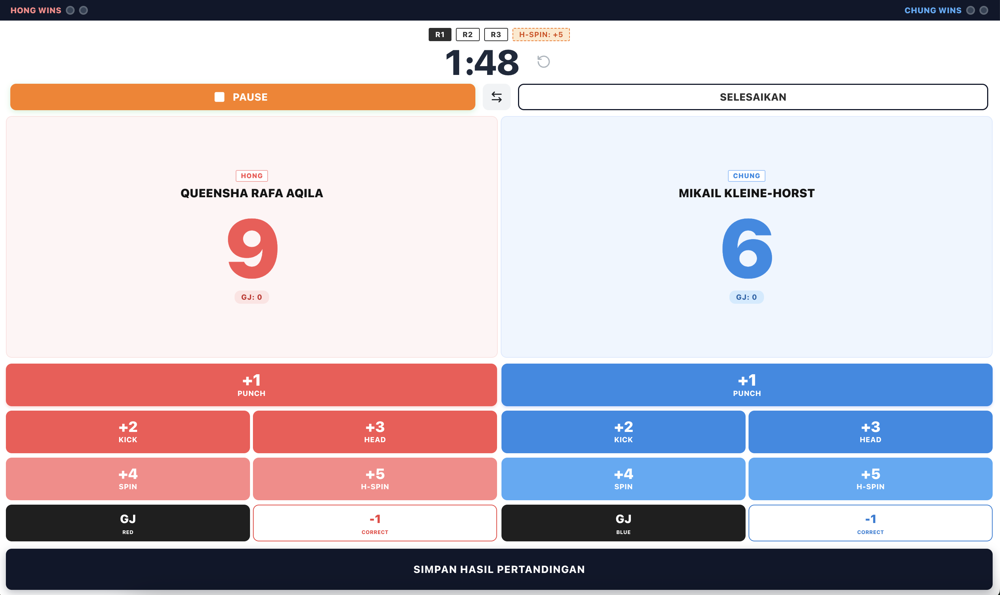  
  *Gambar 3.3: Arena Scoreboard TV Penonton — Tampilan display live skor pertandingan beresolusi tinggi untuk layar arena.*

### 4. Comprehensive Mitigation & Official Protest Handling
* **Kelebihan Menjual**: Antarmuka khusus bagi Technical Delegate untuk menangani situasi krisis: kartu protes pelatih, penyesuaian skor karena koreksi juri, pergantian wasit mendadak, atau cedera atlet (*Walkover / Disqualification*).
* **Dampak Bisnis**: Menjaga wibawa kejuaraan, semua keputusan juri terekam dalam audit trail digital, dan menekan potensi kericuhan antar-suporter.
* 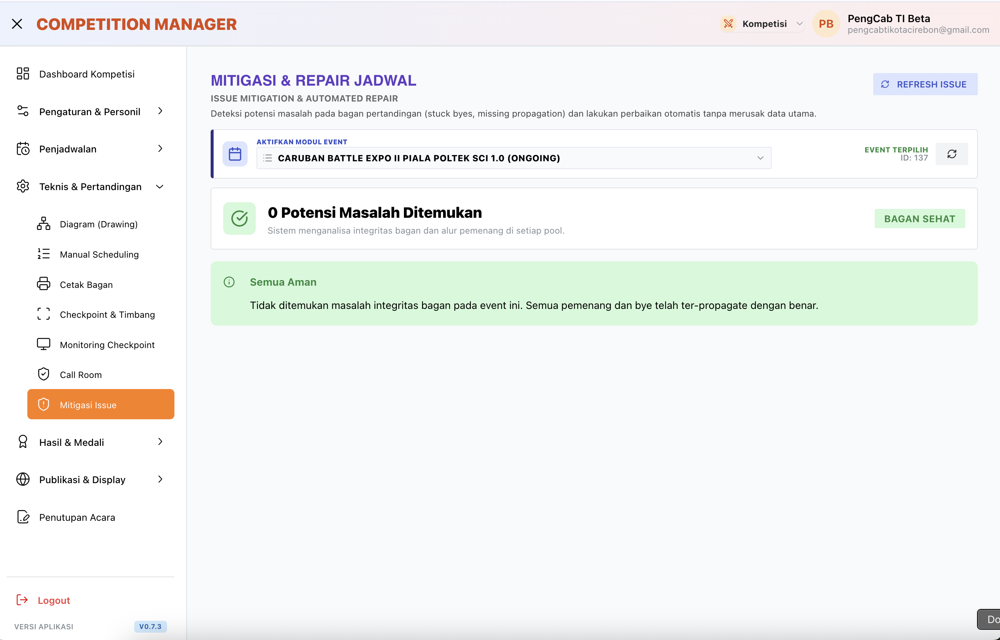  
  *Gambar 3.4: Mitigasi Issue & Protes Wasit — Pencatatan komplain resmi, audit skor, dan resolusi kendala teknis lapangan.*

### 5. Instant 1-Click Official Result Book Generator
* **Kelebihan Menjual**: Otomasi penyusunan **Result Book** (Buku Hasil Kejuaraan) berstandar resmi PBTI/KONI dalam format PDF lengkap: rekap seluruh bagan dengan nama pemenang, klasemen perolehan medali (Emas, Perak, Perunggu), daftar kontingen Juara Umum 1, 2, 3, dan predikat Atlet Terbaik (Best Player).
* **Dampak Bisnis**: Buku hasil dapat diserahkan ke KONI dan dibagikan ke seluruh kontingen tepat saat upacara penutupan tanpa perlu menunggu hari berikutnya.
* 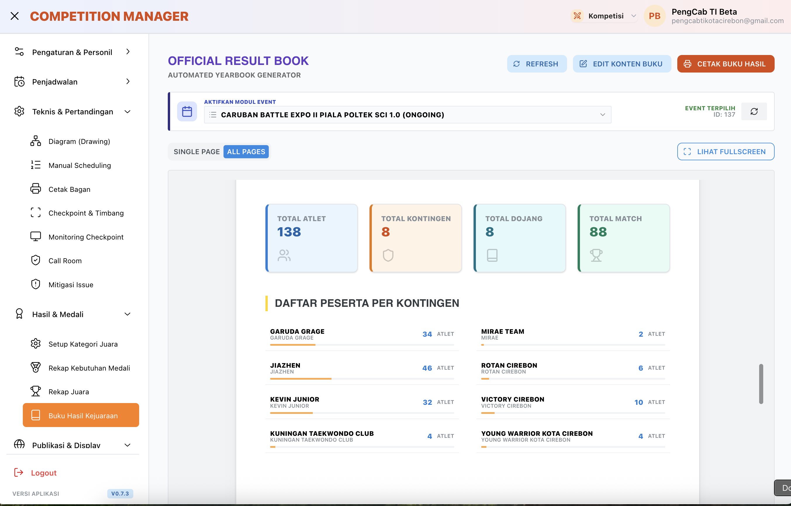  
  *Gambar 3.5: Buku Hasil Kejuaraan (Result Book) — Kompilasi rekapitulasi juara dan klasemen medali otomatis siap cetak.*

## 📊 Matriks Fitur Lengkap Modul Turnamen

| Fitur Turnamen | Route URL | Target Output / Nilai Tambah |
| :--- | :--- | :--- |
| **Dashboard Kompetisi** | `/tournaments/dashboard` | Ringkasan partai aktif, partai selesai, antrean call room, & progres arena. |
| **Rekap Data Peserta** | `/tournaments/participants` | Validasi peserta Kyorugi/Poomsae, kelas umur (Pra-Cadet, Cadet, Junior, Senior). |
| **Setting Pertandingan** | `/tournaments/settings` | Konfigurasi durasi ronde, waktu istirahat, toleransi timbang, sistem poin. |
| **Setting Petugas & Wasit** | `/tournaments/staffs` | Penugasan Wasit Sudut, Wasit Tengah, Operator IT, & Dokter Pertandingan. |
| **Setting Gelanggang (Arena)** | `/tournaments/arenas` | Manajemen gelanggang aktif (Arena 1 s/d Arena 8) dan alokasi matras. |
| **Finalisasi Kategori** | `/tournaments/categories` | Pengelompokan kelas tanding (Under 45kg, Under 48kg, dsb) sebelum drawing. |
| **Manajemen Jadwal** | `/tournaments/schedule` | Timeline urutan nomor partai dan estimasi jam naik gelanggang. |
| **Drawing Bagan (Bracket)** | `/tournaments/drawing` | Generator bagan visual interaktif dengan algoritma netral seeded/random. |
| **Cetak Bagan Venue** | `/tournaments/print-diagram` | Output cetak bagan ukuran besar untuk papan informasi dinding venue. |
| **Checkpoint & Timbang Badan** | `/tournaments/checkpoint` | Loket timbang berat badan atlet dengan scanner barcode/QR ID Card. |
| **Call Room Marshalling** | `/tournaments/call-room` | Monitor pemanggilan atlet 3 match sebelumnya untuk verifikasi body protector. |
| **Mitigasi Issue** | `/tournaments/mitigation` | Modul mitigasi kartu protes, pembatalan poin, dan penyelesaian sengketa partai. |
| **Setup Kategori Juara** | `/tournaments/results/setup` | Pengaturan kuota juara (Juara 3 Bersama vs Playoff Perebutan Tempat Ketiga). |
| **Rekap Kebutuhan Medali** | `/tournaments/reports/medals` | Estimasi jumlah fisik medali emas, perak, dan perunggu yang harus disediakan. |
| **Rekapitulasi Juara** | `/tournaments/results` | Daftar peraih medali per kelas tanding dan penetapan Juara Umum. |
| **Buku Hasil (Result Book)** | `/tournaments/result-book` | Generator dokumen PDF resmi seluruh hasil turnamen lengkap dalam 1 file. |
| **Scoreboard TV Arena Publik** | `/v2/competitions/public/arena-scoreboard` | Tampilan fullscreen digital scoring pertandingan untuk TV gelanggang. |
| **Bagan & Display Publik** | `/tournaments/public/brackets` | Web display interaktif untuk penonton melihat update progres bagan di ponsel. |
| **Penutupan Acara** | `/tournaments/closing` | Penutupan event, finalisasi berita acara kejuaraan, dan penguncian data skor. |

---

 

# 🌐 Keunggulan Arsitektur: Dual-Mode Hybrid Registration

Salah satu keunggulan terbesar **DAYS Executive** dibandingkan perangkat lunak lain adalah arsitektur **Dual-Mode Hybrid Intake**. Sistem ini dapat beroperasi dalam dua mode sekaligus secara harmonis:

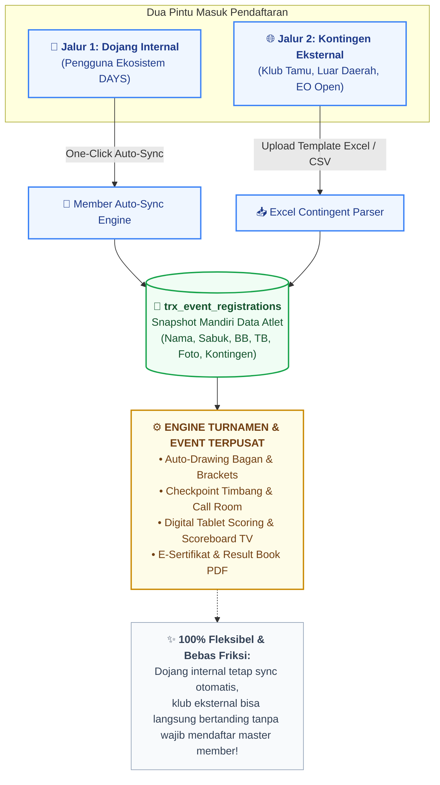

### Mengapa Ini Menguntungkan Secara Bisnis?
1. **Tidak Ada Hambatan Adopsi**: Panitia kejuaraan open sering gagal mengadopsi software baru karena klub tamu menolak mendaftar ke sistem membership yang rumit. Dengan Dojang.id, klub tamu cukup mengirimkan file spreadsheet Excel standar panitia.
2. **Snapshot Data Terisolasi**: Perubahan nama atau tingkatan sabuk pada event tertentu tidak merusak master database atlet dojang, karena data tersimpan sebagai snapshot independen di tabel `trx_event_registrations`.
3. **Kesiapan Jaringan Venue (Offline/Local Mesh Resilience)**: Dirancang untuk mendukung sinkronisasi terminal arena lokal di gedung olahraga (GOR) yang minim sinyal internet, menjamin kelancaran pertandingan tanpa resiko lag.

---

 

# 💼 Model Lisensi, Paket Komersial (SaaS), & Kalkulasi ROI

Penyelenggaraan event beladiri di Indonesia memiliki perputaran ekonomi yang signifikan:
- **Rata-rata Peserta Turnamen**: 500 s/d 2.500 atlet per event.
- **Biaya Pendaftaran**: Rp 250.000 – Rp 450.000 per atlet.
- **Perputaran Kas Panitia**: Rp 150 Juta – Rp 900 Juta per kejuaraan.
- **Alokasi Anggaran IT & Scoring**: 5% – 10% dari omzet event.

### A. Model Sewa per Event (Pay-per-Event SaaS)

| Paket Layanan | Sasaran Pengguna | Fitur & Batasan Operasional | Rentang Harga Sewa |
| :--- | :--- | :--- | :---: |
| **🥉 BASIC** | • Dojang UKT Mandiri • Kejuaraan Internal / Festival Sabuk Putih-Kuning | • Maksimal 300 Peserta • 1 - 2 Pos/Gelanggang • Registrasi & E-Sertifikat QR • Scoring sederhana (tanpa Call Room) • Self-service via Cloud Server | **Rp 1.500.000 – Rp 3.500.000** *(atau Rp 7.500 – Rp 10.000 / atlet)* |
| **🥈 STANDARD** | • Kejurcab Pengcab Kota/Kabupaten • Open Tournament Regional | • Maksimal 800 Peserta • 3 - 4 Gelanggang Aktif • Auto-Drawing Bagan & Cetak Bagan Fisik • Checkpoint Timbang & Call Room Marshalling • Live Scoring Terminal & Scoreboard TV Display • Export Instan Result Book PDF | **Rp 7.500.000 – Rp 15.000.000** per event |
| **🥇 ENTERPRISE** | • Kejurda / Kejurnas • Open Tournament Nasional Skala Besar • Event Organizer (EO) Profesional | • **Unlimited Peserta** (>1.000 - 3.000+ atlet) • **Multi-Arena (5 - 8+ Gelanggang Simultan)** • White-Label (Branding & Logo Event Sendiri) • Integrasi Live Stream Score Overlay • Dedicated Cloud High-Concurrency Server • Pendampingan Tim Teknisi On-Site di Venue | **Rp 25.000.000 – Rp 50.000.000** per event |

---

### B. Model Lisensi Putus & Proyek B2B/B2G Kustom

Untuk institusi federasi resmi (KONI Provinsi, Pengurus Besar Cabang Olahraga, Kemenpora, atau Vendor EO Resmi):

| Model Lisensi Putus | Lingkup Deliverables | Nilai Investasi |
| :--- | :--- | :---: |
| **Custom White-Label Deployment** | Sistem dideploy pada domain dan server privat klien (`kejuaraan.pengprov-taekwondo.org`), logo dan tema disesuaikan, integrasi payment gateway lokal, serta garansi operasional 6 bulan. | **Rp 60.000.000 – Rp 120.000.000** |
| **Enterprise Full Source Code & Custom Rules** | Penyerahan source code lengkap, penyesuaian aturan penilaian khusus (misal integrasi sensor nirkabel DSS/PSS pihak ketiga, cabang beladiri lain seperti Pencak Silat/Karate), pelatihan staf, & SLA tahunan. | **Rp 150.000.000 – Rp 350.000.000** |
| **Annual Support & Retainer Maintenance (SLA)** | Cloud maintenance, backup rutin database atlet daerah, patch keamanan, dan kesiapan teknisi on-call saat agenda kejuaraan daerah berlangsung. | **Rp 25.000.000 – Rp 60.000.000** / tahun |

---

### C. Analisis Return on Investment (ROI) bagi Penyelenggara

1. **Efisiensi Tenaga Kerja Panitia**: Memangkas kebutuhan staf meja pertandingan hingga **65%** (tidak perlu lagi petugas pencatat manual, pengantar kertas skor antar-lapangan, atau pengetik sertifikat lembur semalaman).
2. **Nol Biaya Kertas Sertifikat & Cetak Bagan**: Meniadakan resiko salah cetak ribuan blanko sertifikat fisik; seluruhnya dialihkan ke e-sertifikat terverifikasi QR yang dapat dicetak mandiri oleh kontingen.
3. **Penyelesaian Tepat Waktu**: Meniadakan denda sewa gedung olahraga (GOR) akibat jadwal molor berjam-jam, berkat algoritma penyeimbang jadwal (*Load Balancer*) dan sistem antrean *Call Room*.
4. **Peningkatan Reputasi & Kepuasan Peserta**: Meningkatkan kepercayaan pelatih dan wali murid berkat drawing yang netral, tampilan scoreboard modern, dan Result Book yang terbit tepat di akhir acara.

---

 

# 🚀 Langkah Selanjutnya (Next Steps & Onboarding)

Siap mentransformasi tata kelola federasi dan penyelenggaraan kejuaraan olahraga beladiri Anda ke level profesional?

1. **Jadwalkan Demo Langsung**: Saksikan simulasi operasional dari pembuatan bagan turnamen hingga live scoring di scoreboard arena.
2. **Simulasi Uji Coba Pilot Project**: Uji coba sistem secara gratis pada 1 event UKT dojang atau kejuaraan internal skala kecil Anda.
3. **Konsultasi Kustomisasi Wilayah**: Tim engineering kami siap mendampingi penyesuaian regulasi poin dan struktur organisasi daerah Anda.

**Hubungi Tim Kemitraan Eksekutif:**  
📧 Email: **executive@dojang.id** / **partners@dojang.id**  
🌐 Portal: [https://dojang.id/executive](https://dojang.id/executive)  
📍 Jakarta, Indonesia
