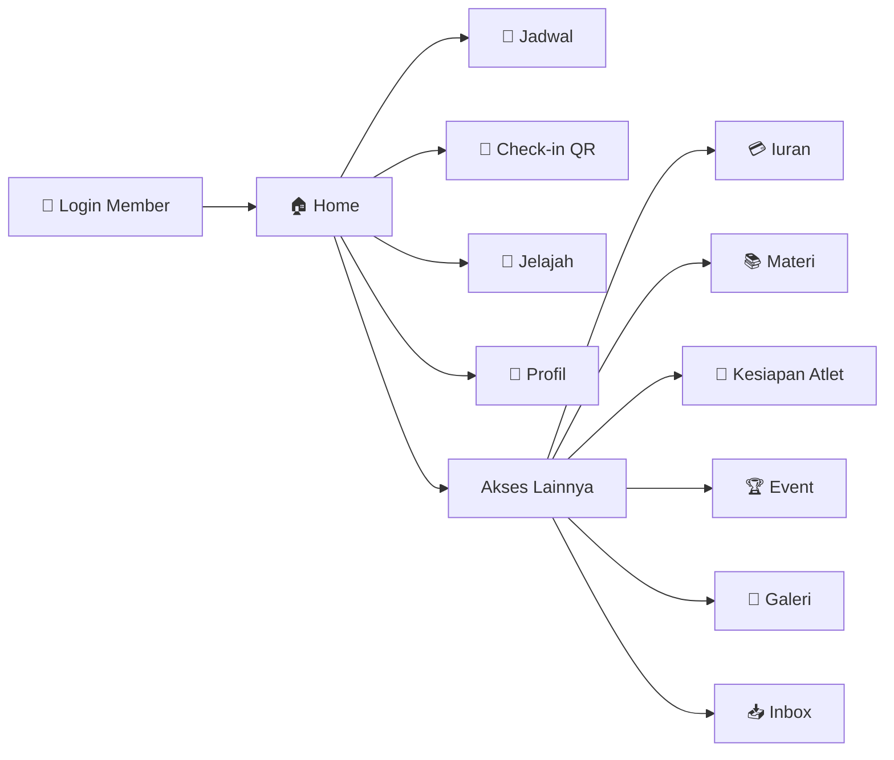
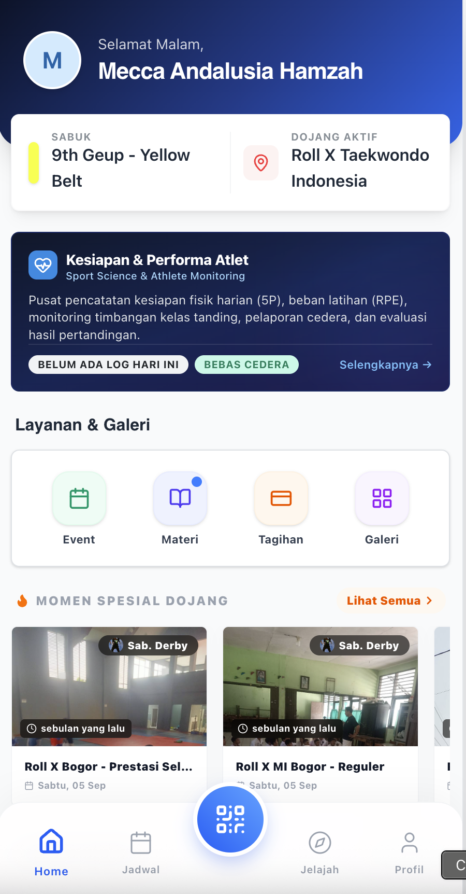
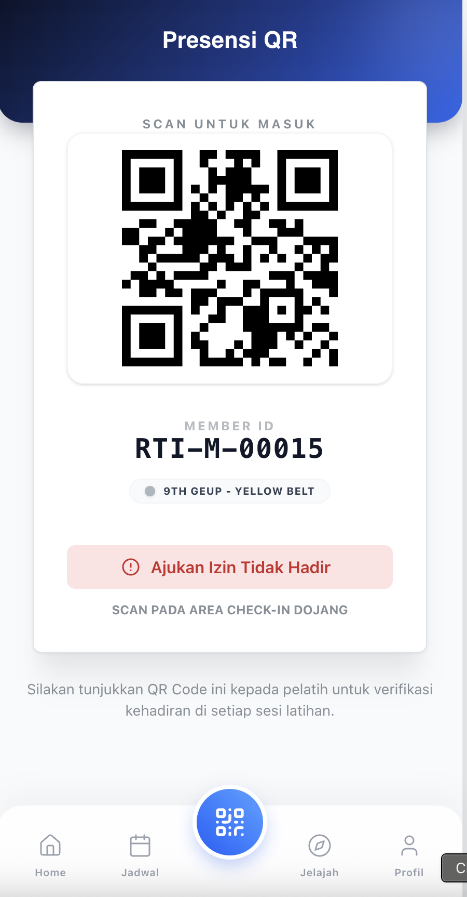
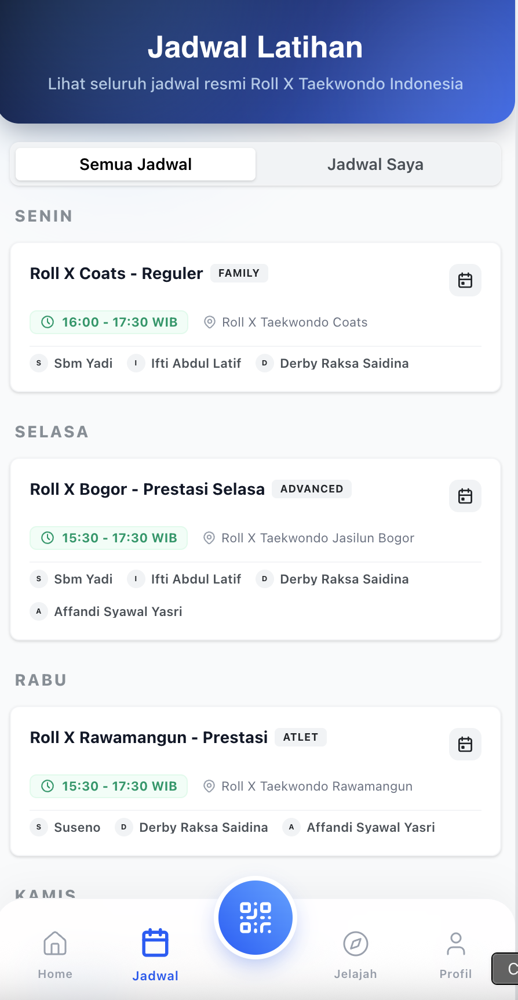
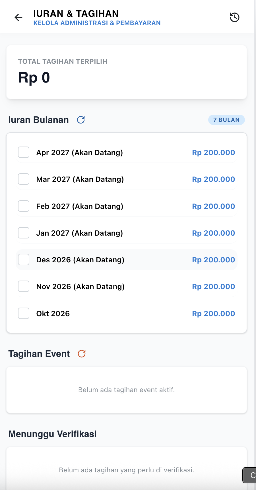
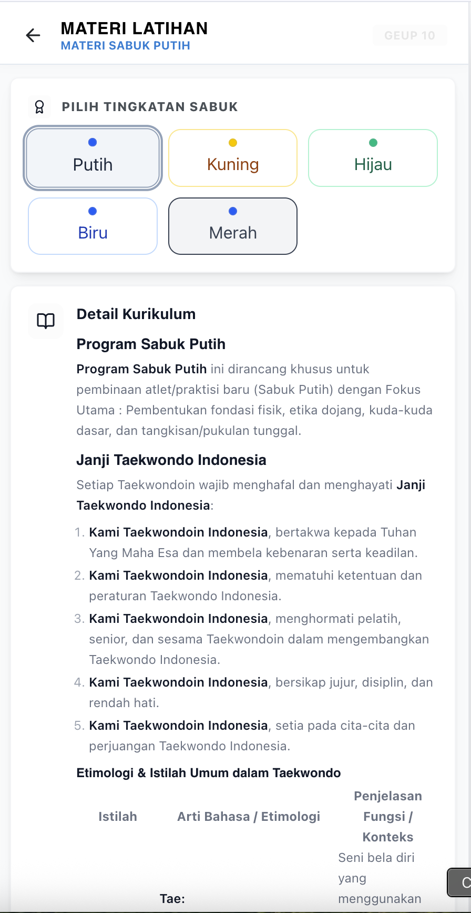
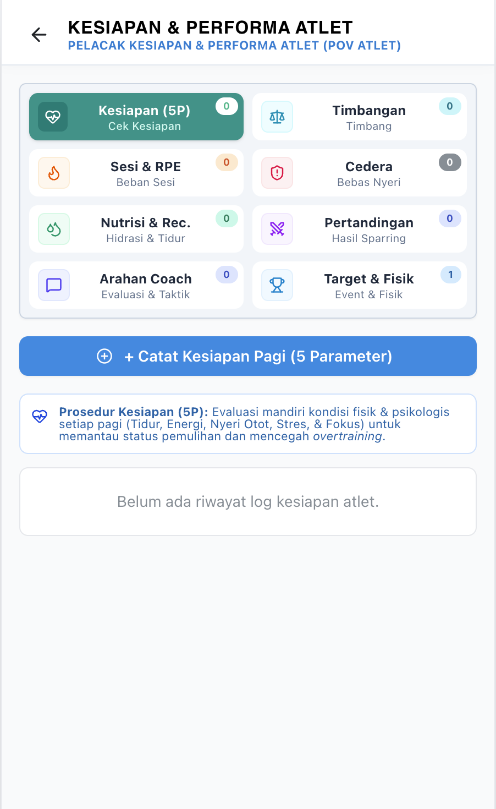
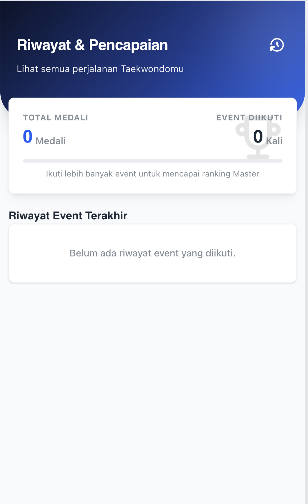
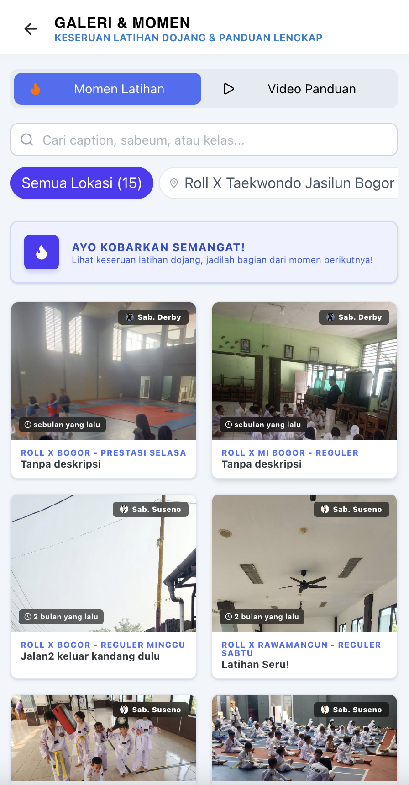
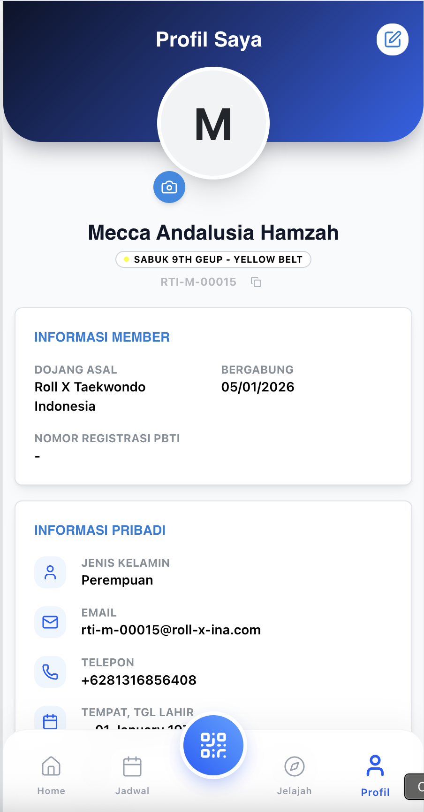

# 🥋 DOOJANG.ID Member — Official Marketing Kit & Product Deck

> **Aplikasi Mobile Pribadi untuk Atlet & Murid Taekwondo**  
> Check-in QR, jadwal latihan, iuran digital, materi belajar, kesiapan atlet, hingga pendaftaran kejuaraan — semua di satu aplikasi di genggaman murid dan orang tua.

---

## 🎯 Mengapa DOOJANG.ID Member? (Problem vs. Solution)

| ❌ Kendala Murid & Orang Tua | ✅ Solusi dengan DOOJANG.ID Member |
| :--- | :--- |
| **Lupa Jadwal Latihan**: Info jadwal tersebar di grup chat dan sering berubah. | **Jadwal Terdekat Terpusat**: Jadwal latihan per kelas/lokasi tampil di beranda. |
| **Absensi Manual & Antre**: Murid menunggu dipanggil di buku absen. | **Check-in QR Cepat**: Tombol Check-in di tengah navigasi, plus **Izin Tidak Hadir** langsung dari aplikasi. |
| **Bayar Iuran Tidak Jelas**: Tidak tahu tagihan bulan ini, sudah dikonfirmasi atau belum. | **Iuran & Tagihan Event Transparan**: Total tagihan, status *Menunggu Verifikasi*, riwayat, dan **Kwitansi Digital**. |
| **Materi Latihan Tidak Ada di Rumah**: Murid lupa urutan jurus dan syarat ujian. | **Materi Belajar Digital**: Akses materi dan kurikulum kapan saja. |
| **Persiapan Kejuaraan Tanpa Data**: Atlet tidak punya catatan kondisi fisik, tidur, berat badan, dan cedera. | **Athlete Readiness Tracker**: Catatan kesiapan harian, berat badan, beban latihan, nutrisi, cedera, dan rekap tanding. |
| **Daftar Kejuaraan Ribet**: Mengisi formulir dan menyerahkan berkas fisik. | **Pendaftaran Event Digital** dan **Riwayat Event** langsung dari aplikasi. |

---

## 👥 Target Pengguna

1. **Murid & Atlet** — Memantau jadwal, kehadiran, kesiapan, dan prestasi pribadi.
2. **Orang Tua / Wali** — Mengawasi kehadiran anak, membayar iuran, dan menerima pengumuman.
3. **Atlet Pelatnas/Daerah** — Mengelola performa, berat badan, dan pemulihan menuju kejuaraan.

---

## 📱 Navigasi Utama (Bottom Navigation)

Aplikasi berformat mobile-first dengan 5 tab utama:

| Tab | Route | Fungsi |
| :--- | :--- | :--- |
| 🏠 **Home** | `/dashboard` | Ringkasan, jadwal terdekat, layanan & galeri, akses cepat |
| 📅 **Jadwal** | `/schedules` | Jadwal latihan lengkap |
| 🔳 **Check-in** *(tombol tengah)* | `/checkin` | QR kehadiran & izin tidak hadir |
| 🧭 **Jelajah** | `/explore` | Temukan event dan informasi dojang |
| 👤 **Profil** | `/profile` | Data pribadi, fisik & PBTI, kontak darurat |

---

 

# 📚 SHOWCASE PER FITUR

---

## 1. 🏠 Home — Pusat Aktivitas Harian

> **Route**: `/dashboard`

* **Kelebihan Menjual**: Beranda personal berisi **Jadwal Terdekat**, **Layanan & Galeri**, **Akses Lainnya**, serta kejutan **Selamat Ulang Tahun!** pada hari spesial murid.
* **Dampak Bisnis**: Murid selalu tahu agenda berikutnya sehingga kehadiran naik; ucapan ulang tahun membangun kedekatan dan retensi.

  
*Gambar 1: Home — jadwal terdekat, layanan, dan akses cepat dalam satu layar.*

---

## 2. 🔳 Check-in QR & Izin Tidak Hadir

> **Route**: `/checkin` · Riwayat: `/history`

* **Kelebihan Menjual**: Tombol Check-in menonjol di tengah navigasi. Murid menunjukkan QR ke pelatih; jika berhalangan, ajukan **Izin Tidak Hadir** tanpa perlu menghubungi pelatih satu per satu. Riwayat kehadiran tersedia di halaman Riwayat.
* **Dampak Bisnis**: Presensi akurat tanpa buku absen, dan data kehadiran menjadi dasar laporan MAU dan analitik dojang.

  
*Gambar 2: Check-in QR — kehadiran cepat dan pengajuan izin.*

---

## 3. 📅 Jadwal Latihan

> **Route**: `/schedules`

* **Kelebihan Menjual**: Jadwal latihan per lokasi, kelas, dan hari — sinkron dengan jadwal yang diatur Admin Dojang.
* **Dampak Bisnis**: Perubahan jadwal langsung terlihat oleh semua murid, mengurangi pertanyaan berulang ke pelatih.

  
*Gambar 3: Jadwal Latihan — tampilan jadwal personal murid.*

---

## 4. 💳 Iuran, Tagihan Event & Kwitansi Digital

> **Route**: `/payments` · Riwayat: `/payments/history`

| Bagian | Isi |
| :--- | :--- |
| **Total Tagihan** | Ringkasan nominal yang harus dibayar. |
| **Iuran Bulanan** | Daftar iuran per bulan beserta status. |
| **Tagihan Event** | Biaya pendaftaran kejuaraan/UKT. |
| **Menunggu Verifikasi** | Pembayaran yang sudah dikirim dan menunggu konfirmasi admin. |
| **Rincian Bayar & Kwitansi Digital** | Bukti pembayaran resmi yang bisa disimpan. |

* **Dampak Bisnis**: Orang tua tahu persis tagihan dan status bayar; dojang menerima konfirmasi lebih cepat dan tunggakan menurun.

  
*Gambar 4: Iuran & Tagihan — status pembayaran dan kwitansi digital.*

---

## 5. 📚 Materi Belajar

> **Route**: `/materials`

* **Kelebihan Menjual**: Materi latihan dan kurikulum Taekwondo dalam bentuk digital yang dapat dibuka murid saat berlatih mandiri di rumah.
* **Dampak Bisnis**: Murid lebih siap menghadapi UKT dan kualitas latihan mandiri meningkat.

  
*Gambar 5: Materi Belajar — akses kurikulum dan teknik kapan saja.*

---

## 6. 💪 Athlete Readiness — Kesiapan & Performa Atlet

> **Route**: `/readiness` · Riwayat fisik: `/physical-history`

Fitur unggulan untuk atlet kompetitif. Data dikirim ke pelatih sehingga program latihan disesuaikan kondisi atlet.

| Modul Catatan | Isi | Dilihat Pelatih |
| :--- | :--- | :---: |
| **Kesiapan Harian 5P** | Kualitas tidur, energi, nyeri otot, stres, kesiapan mental → skor kesiapan (%) | ✅ |
| **Timbangan & Target Kelas** | Berat badan aktual vs target kelas tanding | ✅ |
| **Beban Latihan (Session-RPE)** | Durasi × skala usaha (1–10) | ✅ |
| **Laporan Nyeri/Cedera** | Bagian tubuh, skala nyeri, status pemulihan | ✅ |
| **Nutrisi & Hidrasi** | Air, jam tidur, kepatuhan diet, modalitas recovery | ✅ |
| **Rekap Tanding** | Lawan, hasil, skor, catatan taktik | ✅ |

**Indikator Kesiapan:**
- 🟢 **≥ 80%** — Prima, siap sparring intensif.
- 🔵 **60–79%** — Baik, latihan teknik reguler.
- 🔴 **< 60%** — Butuh pemulihan, volume latihan diturunkan.

* **Dampak Bisnis**: Atlet berlatih berbasis data, risiko cedera berkurang, dan dojang tampil sebagai pusat pembinaan prestasi yang profesional.

  
*Gambar 6: Athlete Readiness — skor kesiapan, timbangan, dan beban latihan atlet.*

---

## 7. 🏆 Event & Kejuaraan

> **Route**: `/events`, `/events/register/:id?`, `/explore`

* **Kelebihan Menjual**: Atlet menemukan event lewat **Jelajah**, mendaftar langsung, dan melihat **Riwayat Event** miliknya. Tagihan event otomatis muncul di halaman iuran.
* **Dampak Bisnis**: Partisipasi kejuaraan naik karena prosesnya mudah, dan jejak prestasi atlet tersimpan.

  
*Gambar 7: Event — pendaftaran dan riwayat kejuaraan atlet.*

---

## 8. 📸 Galeri & Momen Latihan · 📥 Inbox

> **Route**: `/gallery`, `/inbox`

* **Galeri**: Foto dan video momen latihan dari dojang; tautan momen dapat dibuka publik (`/gallery?moment_id=...`) sehingga mudah dibagikan ke keluarga.
* **Inbox**: Pengumuman dan notifikasi dari dojang, termasuk status pendaftaran dan pembayaran.
* **Dampak Bisnis**: Orang tua merasa terlibat dan bangga — promosi gratis lewat media sosial.

  
*Gambar 8: Galeri Momen — dokumentasi latihan dan kegiatan dojang.*

---

## 9. 👤 Profil Member

> **Route**: `/profile`

* **Informasi Member** — Identitas keanggotaan dan tingkat sabuk.
* **Data Pribadi** — Biodata lengkap yang dapat diperbarui.
* **Atribut Fisik & PBTI** — Berat, tinggi, dan data keanggotaan PBTI; perubahan tercatat di **Riwayat Fisik** (`/physical-history`, "Log Perubahan Data").
* **Darurat & Medis / Kontak Darurat** — Data penting untuk keselamatan saat latihan dan kejuaraan.
* **Dampak Bisnis**: Data profil yang selalu mutakhir dipakai otomatis saat pendaftaran event dan UKT.

  
*Gambar 9: Profil — data pribadi, fisik & PBTI, dan kontak darurat.*

---

## 🚧 Roadmap (Rute Tersedia, Fitur Dalam Pengembangan)

Rute berikut sudah disiapkan namun masih menampilkan halaman *placeholder*: **UKT** (`/ukt`), **Turnamen** (`/tournaments`), dan **Sertifikat** (`/certificates`). Fitur ini direncanakan terhubung dengan modul Executive (hasil UKT, e-sertifikat QR, dan result book). **Jangan dipromosikan sebagai fitur siap pakai.**

---

## 📊 Matriks Fitur Member

| Kategori | Fitur | Status |
| :--- | :--- | :---: |
| **Beranda** | Jadwal terdekat, galeri, akses cepat, ucapan ulang tahun | ✅ Live |
| **Kehadiran** | Check-in QR, izin tidak hadir, riwayat | ✅ Live |
| **Jadwal** | Jadwal latihan personal | ✅ Live |
| **Keuangan** | Iuran bulanan, tagihan event, verifikasi, kwitansi digital, riwayat | ✅ Live |
| **Belajar** | Materi & kurikulum | ✅ Live |
| **Performa Atlet** | Kesiapan 5P, berat badan, beban latihan, cedera, nutrisi, rekap tanding | ✅ Live |
| **Event** | Jelajah, pendaftaran, riwayat | ✅ Live |
| **Komunikasi** | Inbox, galeri momen | ✅ Live |
| **Profil** | Data pribadi, fisik & PBTI, kontak darurat, riwayat fisik | ✅ Live |
| **UKT / Turnamen / Sertifikat** | Hasil dan e-sertifikat di aplikasi | 🚧 Roadmap |

---

## 💼 Nilai Bisnis bagi Dojang

1. **Kehadiran Naik** — Jadwal dan pengingat selalu di tangan murid.
2. **Iuran Lebih Tertib** — Status bayar jelas, kwitansi otomatis.
3. **Retensi Meningkat** — Galeri, ucapan ulang tahun, dan materi belajar menjaga keterlibatan.
4. **Citra Profesional** — Aplikasi bermerek dojang menaikkan nilai di mata orang tua.
5. **Pembinaan Berbasis Data** — Athlete Readiness menjadi nilai jual untuk program prestasi.

---

## 🚀 Langkah Selanjutnya

Hubungi tim kami untuk **demo aplikasi member**, aktivasi akun murid massal, dan pelatihan orang tua/wali agar dojang Anda siap digital.
