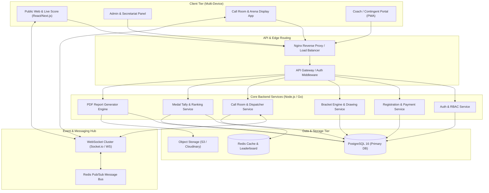
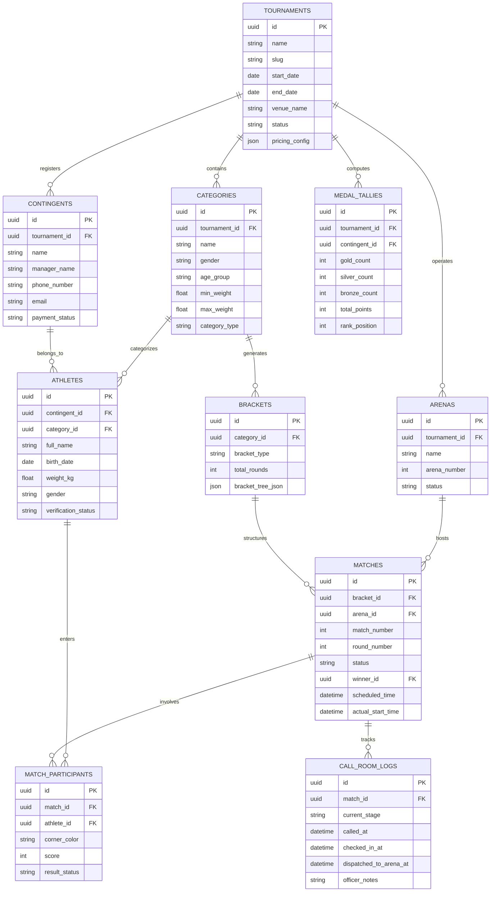

# Tournament Management System (TMS) — System Architecture & Tech Stack

## 1. High-Level System Architecture

Tournament Management System (TMS) dirancang dengan arsitektur micro-services / modular monolith berbasis event-driven untuk menangani traffic tinggi selama hari-H kejuaraan, pengiriman pesan realtime via WebSockets, serta generasi PDF berkecepatan tinggi.

---

## 2. Database Schema (Entity Relationship Diagram)

Berikut adalah Skema Database lengkap (*ERD*) dalam bentuk Mermaid diagram yang mengatur hierarki data dari Event, Kontingen, Atlet, Bagan Pertandingan, Status Call Room, hingga Rekapitulasi Medali.

---

## 3. Tech Stack & Integration Specifications

| Layer | Technology | Justification & Role |
| :--- | :--- | :--- |
| **Frontend Framework** | Next.js 14 (App Router) + React 18 | SSR/SSG untuk halaman publik, SPA responsif untuk Admin Dashboard & Call Room Display. |
| **UI Styling & Design** | Tailwind CSS + Shadcn UI + Lucide Icons | Styling modern, responsif, glassmorphism UI untuk layar arena & display call room. |
| **State & Query** | TanStack Query v5 + Zustand | Client state management efisien & sync data server otomatis. |
| **Backend Core** | Node.js (TypeScript) / Express / NestJS | Asynchronous IO performa tinggi untuk penanganan API request dan event emitter. |
| **Realtime Engine** | Socket.io + Redis Adapter | Event-driven WebSocket broadcasting untuk Call Room queue, Arena status, dan Live Scores. |
| **Bracket Engine** | Custom TypeScript Tree Algorithm | Generasi bagan otomatis (Single/Double Elimination, Round Robin) + seeding logic. |
| **PDF Report Generator** | Puppeteer / React-PDF Engine | Rendering HTML/CSS template ke PDF server-side dengan kecepatan tinggi & layout presisi. |
| **Database** | PostgreSQL 16 (Prisma / Kysely ORM) | Relational Integrity ketat untuk data transaksi, registrasi, dan skor pertandingan. |
| **Cache & Pub/Sub** | Redis 7 | Caching data bracket, leaderboard temporary, dan Pub/Sub untuk Socket.io cluster. |
| **Storage & Media** | AWS S3 / Cloudinary | Penyimpanan berkas foto atlet, dokumen akta, dan PDF Official Result Book. |
| **Payment Gateway** | Midtrans / Xendit API | Opsi pembayaran otomatis (QRIS, Virtual Account, Credit Card) untuk registrasi kontingen. |
| **Notification Engine** | WhatsApp Business API (Fonnte / Wablas) | Pengiriman otomatis notifikasi jadwal & panggilan atlet Call Room ke Coach. |

---

## 4. Security, Auth & Multi-Tenant Privacy Model

### 4.1 Authentication & RBAC (Role-Based Access Control)
Sistem menerapkan **JWT (JSON Web Token)** dengan dual-token strategy (Access Token 15 menit & Refresh Token 7 hari stored in HttpOnly Cookies).

Roles dan Permission Matrix:
- `SUPER_ADMIN`: Akses penuh ke seluruh tenant dan konfigurasi global.
- `EVENT_ORGANIZER`: Mengelola event miliknya, skema harga, tim verifikator, dan keputusan teknis.
- `SECRETARIAT_ADMIN`: Mengelola verifikasi pendaftaran atlet, timbang badan, dan cetak id-card.
- `CALL_ROOM_OFFICER`: Akses khusus modul Call Room, pemanggilan atlet, dan verifikasi perlengkapan.
- `REFEREE_OFFICER / ARENA_OPERATOR`: Menginput skor pertandingan dan mengubah status match (*Started, Finished, WO*).
- `CONTINGENT_MANAGER`: Mengakses portal pendaftaran kontingennya sendiri, memantau status atlet & jadwal.

### 4.2 Multi-Tenant Data Isolation
- Data diisolasi berdasarkan `tournament_id` pada setiap query database.
- Row-Level Security (RLS) diaktifkan pada PostgreSQL untuk menjamin kontingen suatu event tidak dapat melihat atau mengubah data event lain.

### 4.3 Data Privacy & Encryption
- Data sensitif atlet (misal: NIK, tanggal lahir, dokumen identitas) dienkripsi *at-rest* menggunakan `AES-256-GCM`.
- Seluruh komunikasi via HTTPS dengan sertifikat TLS 1.3 dan WebSocket Secure (`wss://`).
