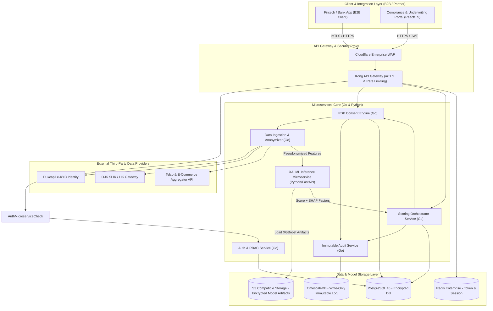
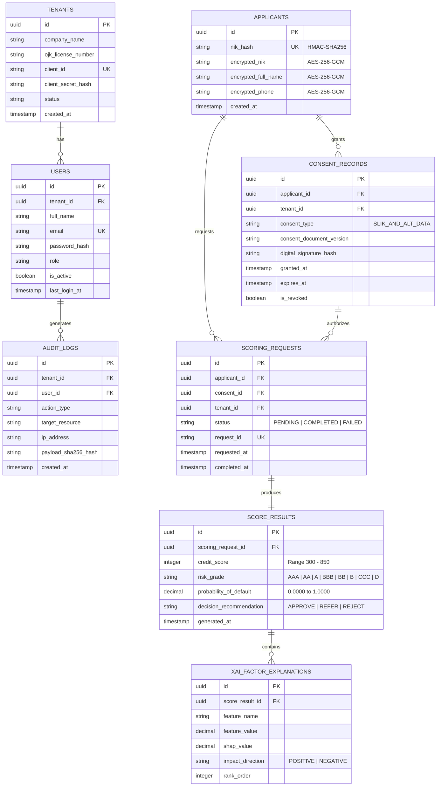

# 01. Architecture & Tech Stack Specification

## 1. System Architecture Diagram

Sistem menggunakan arsitektur Microservices terenkripsi berkinerja tinggi, memisahkan Gateway, Engine Konsen PDP, Integrator Data SLIK/Alternatif, Inference Engine ML/XAI, dan Vault Log Audit.

---

## 2. Database Schema (Mermaid ERD)

---

## 3. Technology Stack Specification

| Component | Technology / Library | Selection Rationale |
| :--- | :--- | :--- |
| **API Gateway** | Kong API Gateway v3.5 | Support mTLS B2B, Rate Limiting, OpenID Connect plugin |
| **Core API Backend** | Go (Golang) 1.22 + Gin Framework | High concurrency (< 20ms microservice latency), low memory footprint |
| **ML/XAI Engine** | Python 3.11 + FastAPI + XGBoost + SHAP | Standard industri ML & Explainable AI (SHAP & LIME) |
| **Primary Database** | PostgreSQL 16 dengan Transparent Data Encryption | SQL ACD compliant, PG-Crypto untuk enkripsi kolom |
| **Immutable Audit Storage**| TimescaleDB (Append-Only PostgreSQL extension) | High throughput time-series logging, partitioning otomatis |
| **Cache & Session** | Redis Enterprise Cluster 7.2 | Rate limit caching, session state management |
| **Object Storage** | MinIO / AWS S3 (AES-256 SSE) | Penyimpanan model ML artifacts (.onnx / .json model) |
| **Message Broker** | Apache Kafka / Redpanda | Asynchronous data ingestion & decoupled audit streaming |
| **Frontend Portal** | React 18 + Vite + TailwindCSS | UI/UX modern untuk Underwriter & Compliance Dashboard |

---

## 4. Security, Privacy & Regulatory Compliance Model

### 4.1 Authentikasi & Otorisasi
- **B2B API Integration:** Mandatory Mutual TLS (mTLS) + OAuth2 Client Credentials Flow (RS256 JWT Signed Keys).
- **Internal Dashboard Access:** OAuth2 PKCE + Mandatory Multi-Factor Authentication (TOTP/FIDO2) + RBAC (`SUPER_ADMIN`, `AUDITOR_OJK`, `UNDERWRITER`, `COMPLIANCE_OFFICER`).

### 4.2 Skema Enkripsi Data (UU PDP & ISO 27001)
- **Data-in-Transit:** Encrypted via TLS 1.3 dengan cipher suite modern (ECDHE-RSA-AES128-GCM-SHA256).
- **Data-at-Rest:** Column-level encryption untuk PII (NIK, Nama, Phone) menggunakan **AES-256-GCM** dengan Key Management Service (AWS KMS / HashiCorp Vault) per-tenant data key rotation.
- **Data Pseudonymization:** NIK di-hash menggunakan `HMAC-SHA256` dengan secret pepper yang disimpan di Hardware Security Module (HSM).

### 4.3 OJK Compliance Safeguards (SEOJK No. 29/SEOJK.05/2021)
1. **Explicit Consent & Revocation:** API scoring menolak pemrosesan jika token konsen expired atau `is_revoked = true`.
2. **Right to be Forgotten:** Mendukung enkripsi ulang key (crypto-shredding) sehingga data PII ter-anonymize irreversibly ketika permohonan pembersihan data diajukan.
3. **Audit Trail Immutability:** Setiap request scoring menghasilkan log transaksi terenkripsi dengan SHA-256 signature chain untuk mencegah tampered log oleh pihak mana pun.
