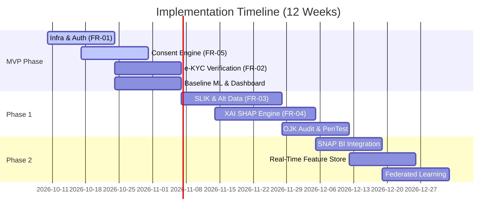

# Implementation Roadmap: OJK-Compliant Credit Scoring Engine

Roadmap ini merincikan tahapan eksekusi sistem dari fase fondasi (MVP) hingga skala enterprise multi-tenant dengan kapabilitas kecerdasan buatan tingkat lanjut.

---

## 1. MVP Milestone (Weeks 1 - 4): Launch Foundations & Regulatory Sandbox

Fokus utama MVP adalah memenuhi kualifikasi registrasi Inovasi Keuangan Digital (IKD) OJK dan mengaktifkan jalur scoring dasar.

### Target Deliverables:
- [x] **Core Architecture & Infra Setup:** Kong Gateway, PostgreSQL terenkripsi, TimescaleDB immutable log.
- [x] **FR-01 User Auth & RBAC:** Implementation mTLS B2B & OAuth2 Client Credentials.
- [x] **FR-05 PDP Consent Engine:** Consent recording, validation, dan basic audit log.
- [x] **FR-02 e-KYC Integration:** Dukcapil demographic verification API.
- [x] **Baseline ML Model:** XGBoost baseline scorecard dengan input data demografi & alternatif telco terbatas.
- [x] **Basic Underwriter Dashboard:** React UI untuk peninjauan skor kredit dan faktor risiko.

### Exit Criteria MVP:
- Berhasil memproses 1.000 simulasi request scoring dengan latency P95 < 1.5 detik.
- Audit log terverifikasi $100\%$ tanpa broken hash chain.

---

## 2. Phase 1 (Weeks 5 - 8): Full Data Ingestion & XAI Governance

Fokus Phase 1 adalah memperluas sumber data alternatif dan memenuhi standar Explainable AI (XAI) OJK.

### Target Deliverables:
- [ ] **FR-03 Advanced Data Ingestion:** Integrasi SLIK OJK Gateway, E-Wallet (OVO/GoPay/Dana), dan E-Commerce transaction aggregators.
- [ ] **FR-04 XAI Engine:** Implementasi SHAP/LIME inference microservice (Python FastAPI) dengan breakdown 5 faktor utama.
- [ ] **Automated Adverse Action Notice:** Generator dokumen alasan penolakan otomatis untuk debitur.
- [ ] **Model Stability Monitoring:** Dashboard PSI (Population Stability Index) & CSI untuk deteksi data drift.
- [ ] **ISO 27001 & OJK Audit Preparation:** Penetration testing, vulnerability scanning, dan finalisasi dokumen compliance.

### Exit Criteria Phase 1:
- Gini coefficient model $\ge 0.55$ pada data validasi independen.
- Lolos pengujian penetrasi keamanan (Zero critical/high vulnerabilities).

---

## 3. Phase 2 (Weeks 9 - 12): Scaling & Advanced Integrations

Fokus Phase 2 adalah otomatisasi tingkat lanjut, integrasi multi-tenant B2B skala besar, dan adaptasi model waktu nyata.

### Target Deliverables:
- [ ] **Federated Learning Module:** Memungkinkan konsorsium bank/P2P melatih model tanpa saling membagikan data mentah debitur.
- [ ] **Real-time Streaming Feature Store:** Apache Flink / Redis Feature Store untuk pembaruan skor kredit secara real-time saat terjadi transaksi baru.
- [ ] **Open Banking API Integration (SNAP BI):** Standardisasi API sesuai standar Bank Indonesia (SNAP) untuk penarikan mutasi rekening bank otomatis.
- [ ] **Self-Service Partner Portal:** Web portal bagi mitra B2B untuk mengelola API keys, webhook notifications, dan kuota pemakaian.

---

## 4. Resource Allocation & Effort Estimation

